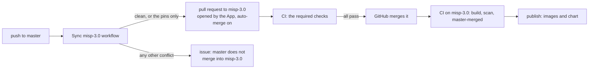

# Developing

## TL;DR

- `mise run test` for the unit tests, `mise run test-integration` for the Compose suite,
  `mise run test-sync` for the three-instance sync suite. Podman runs the containers.
- Settings: curated defaults in `files/misp-config/settings.yaml`, the generated catalogue in
  `settings-upstream.yaml` (`mise run settings-update`).
- New MISP release: the tracking workflow opens a PR with the bump, `files/composer.lock`,
  `files/requirements-misp.txt` and the catalogue; CI's strict checks tell you what changed.
- Release: `mise run release <hotfix|normal|breaking>`, then push master and the tag.
- Pull requests: a draft runs the unit tests only; marking it ready for review runs every suite.
- MISP 3.0 Early Access lives on the `misp-3.0` branch, images `3.0-wip` (see MISP 3.0); a
  workflow merges master into it.

## Setup

[mise](https://mise.jdx.dev/) manages Python, uv, and the virtualenv automatically:

```bash
cd misp-container      # mise creates .venv on enter
mise run test          # unit tests, the chart lint and every chart render validated against the schemas
```

[tests/README.md](tests/README.md) lists every suite, its command and what it covers.

## New MISP releases

`.github/workflows/track-misp-releases.yaml` checks upstream daily. For a new release it
bumps `CORE_TAG`, resolves `files/composer.lock` and `files/requirements-misp.txt` for that
release, builds the image, starts the Compose stack, regenerates the settings catalogue from
that MISP, and opens a PR with all four changes. CI then builds, scans and runs every suite on the PR. Three checks warn
about a change in MISP:

| Check | Fails when |
| --- | --- |
| The upstream guard: `scripts/check_upstream.py`, run in the image by `tests/e2e/test_upstream.py` | MISP changed something the image patches or depends on (table below) |
| The strict settings check: `scripts/update_settings.py --check` in the integration suite | MISP has a setting that neither `settings.yaml` nor the catalogue lists |
| The rejected-`cake` check in the integration suite | MISP refuses a default this image applies |

The PR body lists the new settings by level. A setting that appears there with a value this
image should enforce moves to `settings.yaml`. A default reaches new instances only; to change
the value on existing instances too, set its env var in `base.env`, which the configure Job
enforces on every run.

### What the image depends on in MISP

A failure of the upstream guard names the change, the MISP file and the file of ours to
revisit.

<!-- generated: upstream-checks -->
| Check | MISP file | Ours | Fails when MISP |
|---|---|---|---|
| `worker-queues` | app/Lib/Tools/BackgroundJobsTool.php | files/misp_container/__init__.py WORKER_QUEUES | adds or drops a job queue |
| `worker-group` | app/Lib/Tools/BackgroundJobsTool.php | files/misp_container/__init__.py WORKER_GROUP | finds its workers in another supervisord group |
| `job-keys` | app/Lib/Tools/BackgroundJobsTool.php | files/misp_container/metrics.py _collect_queue_metrics() | keeps waiting or running jobs under other Redis keys |
| `scheduler-tasks` | app/Console/Command/SchedulerWorkerShell.php | files/misp_container/task.py SCHEDULER_COVERAGE | offers periodic work that no task covers |
| `api-routes` | app/Controller | the file and line named in each problem | drops a controller or an action the image calls |
| `attachment-keys` | app/Lib/Tools/AttachmentTool.php, app/Lib/Tools/AWSS3Client.php | files/misp_container/migrate.py attachment_key(), files/misp_container/s3.py | keys attachments another way, or stops sending path-style S3 requests |
| `cakeresque` | app/Config/bootstrap.default.php | Dockerfile stage composer-prep | loads CakeResque while SimpleBackgroundJobs is on |
| `cakelog-streams` | app/Config/bootstrap.default.php | files/misp_container/init.py LOG_BLOCK | configures a CakeLog file stream that the logging block does not drop |
| `shell-streams` | app/Lib/cakephp/lib/Cake/Console/Shell.php | files/misp_container/init.py LOG_BLOCK | checks other stream names before it adds its console streams |
| `relayed-files` | app/Model, app/Lib, app/Controller, app/Console, app/Plugin | files/misp_container/logrelay.py FILES | writes a new file under app/tmp/logs, or stops writing one the relay follows |
| `image-paths` | app/Model/Server.php, app/View/Helper/OrgImgHelper.php | deploy/chart/templates/_helpers.tpl misp.appVolumeMounts, deploy/docker-compose.yml | uploads org logos or custom images to, or reads them from, a directory the volumes do not mount |
| `python-requirements` | requirements.txt | files/requirements-misp.txt | needs a Python package, or a version of one, that the pins do not give (mise run misp-requirements) |
| `log-block-php` | php | files/misp_container/init.py LOG_BLOCK | cannot run the logging block, in either format |
<!-- end generated -->

A new queue needs its name in `WORKER_QUEUES` and `NUM_WORKERS_<QUEUE>` in
`deploy/chart/files/base.env`. New periodic work needs a task in `misp_container/task.py`
(`SCHEDULER_COVERAGE`) and a schedule in `cronjobs.tasks` in `deploy/chart/values.yaml`.

The `Dockerfile` patches two upstream files. Each patch checks its anchor first and fails
the build with the file and the reason when the anchor moved:

- **`app/composer.json`:** the build drops `iglocska/cake-resque`, which SimpleBackgroundJobs
  replaces.
- **CakePHP's `Postgres.php`:** `describe()` resets its sequence match per column
  ([MISP#11172](https://github.com/MISP/MISP/issues/11172)). On a failure, check whether
  the release carries the fix and drop the patch, or adapt it.

## MISP 3.0

This branch builds MISP 3.0 Early Access. The branch model, the sync from master and moving
to a newer `3.0_wip` commit are in [The misp-3.0 branch](#the-misp-30-branch); the images, the
chart and the upgrade of a 2.5 instance are in [docs/misp-3.md](docs/misp-3.md). The code here
differs from master in these places:

| Where | On this branch | Because |
|-------|----------------|---------|
| `Dockerfile` | `CORE_TAG=3.0_wip` with `CORE_COMMIT` pinned; no `cake-resque` patch in `composer-prep`; submodules without recursion; `INSTALL/MARIADB.sql` kept | MISP 3.0 requires no `iglocska/cake-resque`, and only `misp-iconify` nests submodules, over SSH URLs |
| The version marker | `3.0_wip+<CORE_COMMIT>` | It sorts after every `since:` of 2.5 and changes with each pin |
| `db.init_schema()` | Imports `MARIADB.sql` on a MariaDB server | MISP ships a MariaDB baseline with its own collations |
| `settings.yaml` | No switch for background jobs, and four other settings fewer | MISP 3.0 defines none of them; an `s3://` attachments directory turns S3 on |
| The upgrade step | `misp_container.upgrade`, the chart's `upgrade` component, the Compose `upgrade` profile | MISP converts a 2.5 database only with its one-way `cake Admin runUpgrade`; the step runs it while `attributes` has the text column `value1`, which the last migration drops, and the configure step refuses such a database |
| CI | The `upgrade` suite, the `master-merged` job and the `prerelease` job | See The misp-3.0 branch |
| `.gitattributes` | `merge=ours` for `composer.lock` and the settings catalogue | A merge of master keeps the 3.0 ones whole |

On PostgreSQL, MISP 3.0 answers 500 on the events index: `EventIndexStatsBehavior::aggregate()`
names the alias `Event` unquoted. `test_oidc_callback_lands_on_misp` is a strict xfail on
PostgreSQL. It fails once MISP fixes the bug; remove the marker then.

## Releases

Each release has a kind, which sets the chart version. The git tag and the images carry the
MISP version of the `Dockerfile`: `v2.5.48` for the first release of that version, then
`v2.5.48-r1` and on. The chart has its own SemVer version, with the image tag as its
`appVersion`.

| Kind | Command | Chart version | For |
|------|---------|---------------|-----|
| `normal` | `mise run release normal` | minor up: `1.4.2` to `1.5.0` | A new MISP version, new features |
| `hotfix` | `mise run release hotfix` | patch up: `1.4.2` to `1.4.3` | A base image update, a fix, a security patch |
| `breaking` | `mise run release breaking` | major up: `1.4.2` to `2.0.0` | A change that breaks existing values or the upgrade path |

A new MISP version comes in through its bump pull request (see New MISP releases), which
also resolves `files/composer.lock` and the settings catalogue. After the merge, release it
as `normal`.

`scripts/release.py`:
1. Refuses to run off master, with changes to tracked files, or out of step with origin.
2. Computes the next tag from the MISP version and the tags that exist.
3. Reads the chart version that the previous release published, from the `Chart.yaml` of its
   tag, and raises the part the kind names. The first release with a chart publishes the
   version `Chart.yaml` has.
4. Sets `version` and `appVersion` in `deploy/chart/Chart.yaml` and the `MISP_IMAGE_TAG`
   default of the Compose files.
5. Shows the plan and the diff. On a yes it commits and tags; on a no it restores the files.

Publish the release. `--atomic` lands the branch and the tag together:

```bash
git push --atomic origin master <tag>
```

The push starts two runs of the release commit. The `gate` job stops the master run, and the
tag run tests the commit and releases it.

CI runs the tests and the scans, then pushes the images and the chart, and creates a GitHub
Release. The `publish` job refuses a tag whose image tag differs from `appVersion`, an image tag
that GHCR already holds, and a chart version that GHCR already holds.

| Artefact | Version |
|----------|---------|
| `ghcr.io/oivindoh/misp-container`, `-caddy`, `-modules` | the image tag: the git tag without the `v` |
| `oci://ghcr.io/oivindoh/charts/misp` | the chart version of `Chart.yaml` |

## The misp-3.0 branch

The repository builds two lines of MISP, one per branch:

| Line | Branch | MISP | Publishes |
|------|--------|------|-----------|
| Release | `master` | 2.5, at the release tag `CORE_TAG` | on a release tag (`mise run release`): images `2.5.x`, a chart `x.y.z`, a GitHub Release |
| Early Access | `misp-3.0` | 3.0, MISP's `3.0_wip` branch at `CORE_COMMIT` | on every push: images `3.0-wip-<MISP commit>-<commit>` and `3.0-wip`, a chart `3.0.0-wip.<run>.<attempt>` ([its guide](https://github.com/oivindoh/misp-container/blob/misp-3.0/docs/misp-3.md)) |

Where a change goes:

| Change | Pull request to | Then |
|--------|-----------------|------|
| A fix or a feature for both lines | `master` | the sync carries it to `misp-3.0` |
| A new MISP 2.5 release | `master` (the tracking workflow opens it) | the sync keeps the 3.0 pins |
| A change only MISP 3.0 needs, or a newer `3.0_wip` commit | `misp-3.0` | CI publishes a pre-release after the merge |

A change for both lines that lands only on `misp-3.0` never reaches master.

The branch ends when MISP releases 3.0: master then moves to the 3.0 release, and the sync
workflow, `scripts/merge_into_misp3.py`, the `master-merged` job, the branch's
`.gitattributes` and its ruleset go.



CI on `misp-3.0` fails its `master-merged` job while master has commits the branch lacks, and
`publish` needs that job: no 3.0 build ships without the fixes of master. A sync pull
request whose checks fail stays open; the next push to master merges again and updates it.

The ruleset requires a pull request to be up to date with `misp-3.0`, so its merge commit has
the tree its checks ran on. The push run of that merge commit skips `unit` and the suites, and
builds, scans and publishes. A push that merges no pull request runs every job. A sync pull
request that falls behind `misp-3.0` waits for the next push to master, which merges again.
Both branches carry the same `ci.yaml`: its `gate` job tells the branches apart.

`scripts/merge_into_misp3.py` does the merge. Where the branch pins MISP 3.0 and master pins
2.5, the merge keeps the branch's side:

| Pin | Kept by |
|-----|---------|
| `ARG CORE_TAG` and `ARG CORE_COMMIT` in the `Dockerfile` | the script: a conflict of only these lines takes the branch's side |
| `files/composer.lock`, `files/misp-config/settings-upstream.yaml` | the branch's `.gitattributes` (`merge=ours`): the files stay whole |
| `files/requirements-misp.txt` | the branch's `.gitattributes` keeps it through the merge, and the workflow resolves it anew for the branch's MISP commit |
| `AGENTS.md` and the generated regions of the docs | the branch's `.gitattributes` keeps `AGENTS.md` through the merge, and the workflow writes both anew from the merged tree |

### Moving to a newer 3.0_wip commit

1. On a branch from `misp-3.0`, set `ARG CORE_COMMIT` in the `Dockerfile` to the commit.
2. Run `mise run composer-lock` and `mise run misp-requirements`.
3. Run `mise run settings-update`. Remove from `settings.yaml` each setting the summary names
   as stale.
4. Open a pull request to `misp-3.0`. The upgrade suite and the upstream guard report what
   MISP changed.

### When the sync stops at a conflict

The issue "master does not merge into misp-3.0" names the files. Resolve them on a branch from
`misp-3.0`:

```bash
git fetch origin && git switch --no-track -c merge-master origin/misp-3.0
python3 scripts/merge_into_misp3.py origin/master   # merges, or names the files it cannot
git -c merge.ours.driver=true merge origin/master   # resolve those files, then commit
mise run docs                                       # the branch's generated files, into the merge
git commit --all --amend --no-edit
```

Open a pull request to `misp-3.0`, then close the issue.

### Setup

The sync needs these pieces of the repository's settings:

| Piece | Is |
|-------|----|
| GitHub App `misp-v3-sync` | Installed on this repository, with read and write access to contents, pull requests, issues and workflows. It opens the pull requests: a pull request made with `GITHUB_TOKEN` starts no CI, and `GITHUB_TOKEN` may not push a change to a workflow file. |
| Variable `MISP3_SYNC_CLIENT_ID` | The App's client ID |
| Secret `MISP3_SYNC_PRIVATE_KEY` | A private key of the App |
| Ruleset "misp-3.0 requires CI" | Requires the check `ci-ok`, on a pull request that is up to date with `misp-3.0`, before a merge into `misp-3.0`. Repository admins bypass it. |
| Auto-merge | Allowed for the repository. The workflow turns it on for its pull request only while a rule requires checks; without one, the pull request waits for a person. |

`ci-ok` fails when any job of the run failed or was cancelled, and on a draft. Rename it in the
ruleset as well: a required check that never reports holds every sync pull request open.

## Settings Engine

`files/misp-config/settings.yaml` holds the defaults this image applies; each setting has a group and a value.

### Adding a setting

Every setting sits in a group and has a default value. The env var that overrides it is
derived from its name (`MISP.my_setting` -> `MISP_MY_SETTING`); nothing else to declare.
[docs/configuration.md](docs/configuration.md#settings) gives the rule for a set and an unset
env var.

```yaml
settings:
  optional:
    MISP.my_setting:
      value: some-default
```

The YAML type of `value` (bool, int, string) is the type rendered into `config.php` for the
`minimum_config` and `db_enable` groups; env overrides are cast to it.

### Optional fields

- `force: true` -- pass `-f` to `cake Admin setSetting`
- `blank_protection: true` -- skip if the value is empty (and leave the key out of `config.php`)
- `sensitive: true` -- redact the value in logs

### The upstream catalogue

`files/misp-config/settings-upstream.yaml` is generated, never edited: every setting the
running MISP defines that `settings.yaml` does not name, with MISP's own default, description,
type and level, all `track_only`. The source is `cake Admin getSetting all` inside the web
container, which carries each setting's description. The image never applies those values; the file
documents them and makes every MISP setting overridable through its derived env var.

```bash
mise run settings-update              # build the stack, regenerate, tear down
mise run settings-update -- --skip-build
mise run composer-lock                # resolve files/composer.lock for the current CORE_TAG
mise run misp-requirements           # resolve files/requirements-misp.txt for the current CORE_TAG
```

`files/composer.lock` pins MISP's PHP dependencies plus this image's extra packages. The
build installs exactly that lock and fails when it no longer matches upstream's
`composer.json`, which is the signal to run `mise run composer-lock` after a bump.

`files/requirements-misp.txt` pins the Python packages MISP's own scripts import (STIX,
TAXII, ZeroMQ, sample extraction), resolved from MISP's `requirements.txt`. The upstream
guard fails while MISP asks for a package or a version the pins do not give.

The integration suite runs `scripts/update_settings.py --check` and fails when MISP defines a
setting neither file names, or when `settings.yaml` names one MISP no longer defines. It also
fails when the configure step logs a rejected `cake setSetting`. To give a catalogued setting
a default of this image, move it into `settings.yaml`.

### Groups

| Group | Where it lands | Who applies it |
|-------|----------------|----------------|
| `minimum_config`, `db_enable` | `app/Config/config.php`, rendered from the YAML value type (bool, int, string) | Every entrypoint, in every pod, on every start |
| `s3` | `config.php` as well, when `PLUGIN_S3_BUCKET_NAME` is set | Every entrypoint |
| all other groups | the `system_settings` table, in order `initialisation` -> `critical` -> `optional` -> `upstream` -> `gpg` -> `s3` -> `proxy` | The configure Job |
| `upstream` (generated) | only env overrides; defaults are never written | The configure Job |

MISP never reads `SystemSetting::BLOCKED_SETTINGS` (salt, encryption key, password policy,
`python_bin`, `ca_path`, `tmpdir`, `attachments_dir`, `system_setting_db` and a few more) from
the database. Those settings must stay in `minimum_config`.

## Docs from the code

The docs state no fact the code holds by hand. Two mechanisms keep them in step, and the unit
tests fail while either is out of step:

| Mechanism | Covers |
| --- | --- |
| Generated regions, between `<!-- generated: <name> -->` and `<!-- end generated -->`, filled by `scripts/generate_docs.py` | The periodic tasks table, the Secrets table, the value and component tables of the chart, the upstream guard's checks, the unit test modules |
| `tests/test_docs.py` | Every env var, setting, repository path, file name and mise task a doc names exists; the component, task, upstream check, metric, exit code and OIDC tables are complete; the sizes, requests, sync waves, defaults and ports quoted in sentences match the manifests and the code |

Change the source, not the doc: a task description lives in `misp_container/task.py`
(`DESCRIPTIONS`), a Secret's readers in the manifests. Then run `mise run docs`, which also
regenerates `AGENTS.md`. Measured figures (image sizes, startup times, memory, benchmark
times) have no source in the code; they carry the version they were measured on.

## Project Structure

`AGENTS.md` holds the full map, generated from the docstrings, header comments, manifests,
tasks and CI jobs by `scripts/generate_agents_md.py`. After a change to one of them, run
`mise run agents-md`; a unit test fails while the file is stale.
