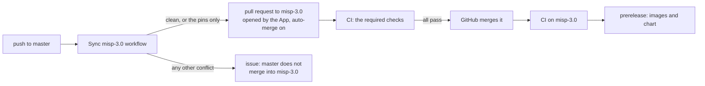

# Developing

## TL;DR

- `mise run test` for the unit tests, `mise run test-integration` for the Compose suite,
  `mise run test-sync` for the three-instance sync suite. Podman runs the containers.
- Settings: curated defaults in `files/misp-config/settings.yaml`, the generated catalogue in
  `settings-upstream.yaml` (`mise run settings-update`).
- New MISP release: the tracking workflow opens a PR with the bump, `files/composer.lock` and
  the catalogue; CI's strict checks tell you what changed.
- Release: `mise run release <hotfix|normal|breaking>`, then push master and the tag.
- MISP 3.0 Early Access lives on the `misp-3.0` branch; a workflow merges master into it.

## Setup

[mise](https://mise.jdx.dev/) manages Python, uv, and the virtualenv automatically:

```bash
cd misp-container      # mise creates .venv on enter
mise run test          # unit tests (~0.3s)
mise run test-upstream     # the MISP in the image against what the image patches or depends on (~5s)
mise run test-integration  # the upstream guard, then the full Compose stack with podman (~2min)
mise run test-integration -- --db-engine postgres   # the same suite on PostgreSQL
mise run test-sync     # hub-spoke 3-instance sync (~2min)
mise run test-all      # unit, the upstream guard, integration, sync, migration
mise run test-chart     # helm lint, and every chart render validated against the schemas
mise run test-kind      # the chart on a kind cluster: install, helm test, task runs, upgrade, rollback
```

## Tests

| Suite | What it covers |
|-------|----------------|
| Unit | Config engine, config.php rendering, advisory lock, database helpers, app/Config preparation, task runner, sync engine, metrics exporter, the Helm chart's renders |
| Upstream guard | The MISP in the image against what the image patches or depends on (see below) |
| Integration | Full Compose stack: HTTP, auth, settings, PHP-FPM, workers, S3, org sync, metrics, modules enrichment, logging |
| Hub-spoke sync | 3 isolated MISP instances: pull, push, tag-filtered sync |
| Migration | The migration: a seeded MariaDB copied onto a second MariaDB with the attachments on the volume, and onto PostgreSQL with the attachments in S3, refusals, the copy checked through the API, and a bucket copied into another |
| Chart render | `helm lint`, then the default values, each component, every component and three more value sets, against the Kubernetes and CRD schemas |
| Kubernetes (kind) | The chart on a kind cluster: install, smoke test, `helm test`, one task of each kind from its CronJob, an upgrade and a rollback, each with a new configure Job and the smoke test |

The integration suite runs every container with `read_only: true` (except web, whose version-gate checks patch `settings.yaml` in place) to catch filesystem writes before Kubernetes does. Under podman the suite also turns off the writable tmpfs that podman gives a read-only container, so `/tmp` is read-only locally as it is under docker and in Kubernetes. `--durations=5` lists the slowest steps. Set `COMPOSE_CMD` and `CONTAINER_CMD` for another runner; CI uses `docker compose` and `docker`.

## New MISP releases

`.github/workflows/track-misp-releases.yaml` checks upstream daily. For a new release it
bumps `CORE_TAG`, resolves `files/composer.lock` for that release, builds the image, starts
the Compose stack, regenerates the settings catalogue from that MISP, and opens a PR with
all three changes. CI then builds, scans and runs every suite on the PR. Three checks warn
about a change in MISP:

| Check | Fails when |
| --- | --- |
| The upstream guard: `scripts/check_upstream.py`, run in the image by `tests/e2e/test_upstream.py` | MISP changed something the image patches or depends on (table below) |
| The strict settings check: `scripts/update_settings.py --check` in the integration suite | MISP has a setting that neither `settings.yaml` nor the catalogue lists |
| The rejected-`cake` check in the integration suite | MISP refuses a default this image applies |

The PR body lists the new settings by level. A setting that appears there with a value this
image should enforce moves to `settings.yaml`; when a release changes a secure default we
already curate, give it `since: <that tag>` so existing instances pick the new value up once.

### What the image depends on in MISP

A failure of the upstream guard names the change, the MISP file and the file of ours to
revisit.

| Check | MISP file | Ours | Fails when MISP |
| --- | --- | --- | --- |
| `worker-queues` | `BackgroundJobsTool.php` | `WORKER_QUEUES` in `misp_container/__init__.py` | adds or drops a job queue |
| `worker-group` | `BackgroundJobsTool.php` | `WORKER_GROUP` in `misp_container/__init__.py` | finds its workers in another supervisord group |
| `job-keys` | `BackgroundJobsTool.php` | `misp_container/metrics.py` | keeps waiting or running jobs under other Redis keys |
| `scheduler-tasks` | `SchedulerWorkerShell.php` | `SCHEDULER_COVERAGE` in `misp_container/task.py` | offers periodic work that no task covers |
| `api-routes` | `app/Controller/` | the file and line that calls the route | drops a controller or an action the image calls |
| `attachment-keys` | `AttachmentTool.php`, `AWSS3Client.php` | `attachment_key()` in `misp_container/migrate.py`, `misp_container/s3.py` | keys attachments another way, or stops sending path-style S3 requests |
| `cakeresque` | `bootstrap.default.php` | the `composer-prep` stage of the `Dockerfile` | loads CakeResque while SimpleBackgroundJobs is on |
| `cakelog-streams` | `bootstrap.default.php` | `LOG_BLOCK` in `misp_container/init.py` | configures a CakeLog file stream that the logging block does not drop |
| `shell-streams` | CakePHP's `Shell.php` | `LOG_BLOCK` in `misp_container/init.py` | checks other stream names before it adds its console streams |
| `relayed-files` | MISP's PHP code | `FILES` in `misp_container/logrelay.py` | writes a new file under `app/tmp/logs`, or stops writing one the relay follows |
| `image-paths` | `Server.php`, `OrgImgHelper.php` | `misp.appVolumeMounts` in `deploy/chart/templates/_helpers.tpl`, `deploy/docker-compose.yml` | uploads org logos or custom images to, or reads them from, a directory the volumes do not mount |
| `log-block-php` | PHP in the image | `LOG_BLOCK` in `misp_container/init.py` | cannot run the logging block, in either format |

A new queue needs its name in `WORKER_QUEUES` and `NUM_WORKERS_<QUEUE>` in
`deploy/chart/files/base.env`. New periodic work needs a task in `misp_container/task.py`
(`SCHEDULER_COVERAGE`) and a schedule in `cronjobs.tasks` in `deploy/chart/values.yaml`.

The `Dockerfile` patches two upstream files. Each patch checks its anchor first and fails
the build with the file and the reason when the anchor moved:

- **`app/composer.json`:** the build drops `iglocska/cake-resque`, which SimpleBackgroundJobs
  replaces.
- **CakePHP's `Postgres.php`:** `describe()` resets its sequence match per column
  ([MISP#11172](https://github.com/MISP/MISP/issues/11172)). On a failure, check whether
  the release carries the fix and drop the patch, or adapt it.

## Releases

Each release has a kind, which sets the chart version. The git tag and the images carry the
MISP version of the `Dockerfile`: `v2.5.48` for the first release of that version, then
`v2.5.48-r1` and on. The chart has its own SemVer version, with the image tag as its
`appVersion`.

| Kind | Command | Chart version | For |
|------|---------|---------------|-----|
| `normal` | `mise run release normal` | minor up: `1.4.2` to `1.5.0` | A new MISP version, new features |
| `hotfix` | `mise run release hotfix` | patch up: `1.4.2` to `1.4.3` | A base image update, a fix, a security patch |
| `breaking` | `mise run release breaking` | major up: `1.4.2` to `2.0.0` | A change that breaks existing values or the upgrade path |

A new MISP version comes in through its bump pull request (see New MISP releases), which
also resolves `files/composer.lock` and the settings catalogue. After the merge, release it
as `normal`.

`scripts/release.py`:
1. Refuses to run off master, with changes to tracked files, or out of step with origin.
2. Computes the next tag from the MISP version and the tags that exist.
3. Reads the chart version that the previous release published, from the `Chart.yaml` of its
   tag, and raises the part the kind names. The first release with a chart publishes the
   version `Chart.yaml` has.
4. Sets `version` and `appVersion` in `deploy/chart/Chart.yaml`, the `MISP_IMAGE_TAG`
   default of the Compose files, and the chart version in the `helm install` examples of
   `README.md` and `docs/kubernetes.md`.
5. Shows the plan and the diff. On a yes it commits and tags; on a no it restores the files.

Publish the release. `--atomic` lands the branch and the tag together:

```bash
git push --atomic origin master <tag>
```

The push starts two runs of the release commit. The `gate` job stops the master run, and the
tag run tests the commit and releases it.

CI runs the tests and the scans, then pushes the images and the chart, and creates a GitHub
Release. The release job refuses a tag whose image tag differs from `appVersion`, an image tag
that GHCR already holds, and a chart version that GHCR already holds.

| Artefact | Version |
|----------|---------|
| `ghcr.io/oivindoh/misp-container`, `-caddy`, `-modules` | the image tag: the git tag without the `v` |
| `oci://ghcr.io/oivindoh/charts/misp` | the chart version of `Chart.yaml` |

## The misp-3.0 branch

The repository builds two lines of MISP, one per branch:

| Line | Branch | MISP | Publishes |
|------|--------|------|-----------|
| Release | `master` | 2.5, at the release tag `CORE_TAG` | on a release tag (`mise run release`): images `2.5.x`, a chart `x.y.z`, a GitHub Release |
| Early Access | `misp-3.0` | 3.0, MISP's `3.0_wip` branch at `CORE_COMMIT` | on every push: images `3.0-wip-<MISP commit>-<commit>` and `3.0-wip`, a chart `3.0.0-wip.<run>.<attempt>` ([its guide](https://github.com/oivindoh/misp-container/blob/misp-3.0/docs/misp-3.md)) |

Where a change goes:

| Change | Pull request to | Then |
|--------|-----------------|------|
| A fix or a feature for both lines | `master` | the sync carries it to `misp-3.0` |
| A new MISP 2.5 release | `master` (the tracking workflow opens it) | the sync keeps the 3.0 pins |
| A change only MISP 3.0 needs, or a newer `3.0_wip` commit | `misp-3.0` | CI publishes a pre-release after the merge |

A change for both lines that lands only on `misp-3.0` never reaches master.



CI on `misp-3.0` fails its `master-merged` job while master has commits the branch lacks, and
`prerelease` needs that job: no 3.0 build ships without the fixes of master. A sync pull
request whose checks fail stays open; the next push to master merges again and updates it.

`scripts/merge_into_misp3.py` does the merge. Where the branch pins MISP 3.0 and master pins
2.5, the merge keeps the branch's side:

| Pin | Kept by |
|-----|---------|
| `ARG CORE_TAG` and `ARG CORE_COMMIT` in the `Dockerfile` | the script: a conflict of only these lines takes the branch's side |
| `files/composer.lock`, `files/misp-config/settings-upstream.yaml` | the branch's `.gitattributes` (`merge=ours`): the files stay whole |
| `AGENTS.md` and the generated regions of the docs | the branch's `.gitattributes` keeps `AGENTS.md` through the merge, and the workflow writes both anew from the merged tree |

### Moving to a newer 3.0_wip commit

1. On a branch from `misp-3.0`, set `ARG CORE_COMMIT` in the `Dockerfile` to the commit.
2. Run `mise run composer-lock`.
3. Run `mise run settings-update`. Remove from `settings.yaml` each setting the summary names
   as stale.
4. Open a pull request to `misp-3.0`. The upgrade suite and the upstream guard report what
   MISP changed.

### When the sync stops at a conflict

The issue "master does not merge into misp-3.0" names the files. Resolve them on a branch from
`misp-3.0`:

```bash
git fetch origin && git switch --no-track -c merge-master origin/misp-3.0
python3 scripts/merge_into_misp3.py origin/master   # merges, or names the files it cannot
git -c merge.ours.driver=true merge origin/master   # resolve those files, then commit
mise run docs                                       # the branch's generated files, into the merge
git commit --all --amend --no-edit
```

Open a pull request to `misp-3.0`, then close the issue.

### Setup

The sync needs these pieces of the repository's settings:

| Piece | Is |
|-------|----|
| GitHub App `misp-v3-sync` | Installed on this repository, with read and write access to contents, pull requests, issues and workflows. It opens the pull requests: a pull request made with `GITHUB_TOKEN` starts no CI, and `GITHUB_TOKEN` may not push a change to a workflow file. |
| Variable `MISP3_SYNC_CLIENT_ID` | The App's client ID |
| Secret `MISP3_SYNC_PRIVATE_KEY` | A private key of the App |
| Ruleset "misp-3.0 requires CI" | Requires the checks below before a merge into `misp-3.0`. Repository admins bypass it. |
| Auto-merge | Allowed for the repository. The workflow turns it on for its pull request only while a rule requires checks; without one, the pull request waits for a person. |

The required checks are the jobs `prerelease` needs: `master-merged`, `unit`, `integration`,
`integration-postgres`, `hub-spoke`, `migration`, `upgrade (mariadb)`, `upgrade (postgres)`,
`kind (mariadb)`, `kind (postgres)` and the three `scan` jobs. Rename a job of the branch's
`ci.yaml` in the ruleset as well: a required check that never reports holds every sync pull
request open.

## Settings Engine

`files/misp-config/settings.yaml` holds the defaults this image applies; each setting has a group and a value.

### Adding a setting

Every setting has a group and a default value. The env var that overrides it is derived from
its name (`MISP.my_setting` -> `MISP_MY_SETTING`); nothing else to declare.

```yaml
MISP.my_setting:
  group: optional
  value: some-default
```

- With the env var set and non-empty, the value is enforced on every configure run.
- Without it, the default is applied once when the setting is missing; the user then owns it
  through the MISP UI.

The YAML type of `value` (bool, int, string) is the type rendered into `config.php` for the
`minimum_config` and `db_enable` groups; env overrides are cast to it.

### Version-gated defaults

Re-apply a default once more on the first configure run of an image at or past a version:

```yaml
settings:
  critical:
    MISP.my_setting:
      value: new-secure-value
      since: v2.5.40
```

The run that applies it records the image version (`misp_docker.defaults_version`), so the
next run leaves the setting to the operator again. Env vars always take precedence.

### Optional fields

- `force: true` -- pass `-f` to `cake Admin setSetting`
- `blank_protection: true` -- skip if the value is empty (and leave the key out of `config.php`)
- `sensitive: true` -- redact the value in logs
- `since: v2.5.40` -- version-gated default

### The upstream catalogue

`files/misp-config/settings-upstream.yaml` is generated, never edited: every setting the
running MISP defines that `settings.yaml` does not name, with MISP's own default, description,
type and level, all `track_only`. The source is `cake Admin getSetting all` inside the web
container; the REST endpoint strips descriptions. The image never applies those values; the file documents
them and makes every MISP setting overridable through its derived env var.

```bash
mise run settings-update              # build the stack, regenerate, tear down
mise run settings-update -- --skip-build
mise run composer-lock                # resolve files/composer.lock for the current CORE_TAG
```

`files/composer.lock` pins MISP's PHP dependencies plus this image's extra packages. The
build installs exactly that lock and fails when it no longer matches upstream's
`composer.json`, which is the signal to run `mise run composer-lock` after a bump.

The integration suite runs `scripts/update_settings.py --check` and fails when MISP defines a
setting neither file names, or when `settings.yaml` names one MISP no longer defines. It also
fails when the configure step logs a rejected `cake setSetting`. To give a catalogued setting
a default of this image, move it into `settings.yaml`.

### Groups

| Group | Where it lands | Who applies it |
|-------|----------------|----------------|
| `minimum_config`, `db_enable` | `app/Config/config.php`, rendered from the YAML value type (bool, int, string) | Every entrypoint, in every pod, on every start |
| `s3` | `config.php` as well, when `PLUGIN_S3_BUCKET_NAME` is set | Every entrypoint |
| all other groups | the `system_settings` table, in order `initialisation` -> `critical` -> `optional` -> `upstream` -> `gpg` -> `s3` -> `proxy` | The configure Job |
| `upstream` (generated) | only env overrides; defaults are never written | The configure Job |

MISP never reads `SystemSetting::BLOCKED_SETTINGS` (salt, encryption key, password policy,
`python_bin`, `ca_path`, `tmpdir`, `attachments_dir`, `system_setting_db` and a few more) from
the database. Those settings must stay in `minimum_config`.

## Docs from the code

The docs state no fact the code holds by hand. Two mechanisms keep them in step, and the unit
tests fail while either is out of step:

| Mechanism | Covers |
| --- | --- |
| Generated regions, between `<!-- generated: <name> -->` and `<!-- end generated -->`, filled by `scripts/generate_docs.py` | The periodic tasks table, the Secrets table, the value and component tables of the chart |
| `tests/test_docs.py` | Every env var, setting, repository path, file name and mise task a doc names exists; the component, task, upstream check, metric, exit code and OIDC tables are complete; the sizes, requests, sync waves, defaults and ports quoted in sentences match the manifests and the code |

Change the source, not the doc: a task description lives in `misp_container/task.py`
(`DESCRIPTIONS`), a Secret's readers in the manifests. Then run `mise run docs`, which also
regenerates `AGENTS.md`. Measured figures (image sizes, startup times, memory, benchmark
times) have no source in the code; they carry the version they were measured on.

## Project Structure

`AGENTS.md` holds the full map, generated from the docstrings, header comments, manifests,
tasks and CI jobs by `scripts/generate_agents_md.py`. After a change to one of them, run
`mise run agents-md`; a unit test fails while the file is stale.

```
files/
  misp_container/           # Python entrypoint library
    __init__.py
    admin.py                # Admin user, GPG, auth configuration
    api.py                  # MISP REST API client (urllib)
    cake.py                 # CakePHP CLI wrapper
    config.py               # Settings diff engine (SettingSpec, SettingsCache)
    db.py                   # Engine-neutral database layer (pymysql or pg8000), lock, schema import
    housekeeping.py         # Nightly deletes (housekeeping component)
    migrate.py              # Copy of an existing MySQL/MariaDB MISP database (migrate component)
    env.py                  # Environment variable defaults
    init.py                 # Per-pod preparation: app/Config rendering, GPG key import
    configure.py            # One-shot configuration (configure Job)
    log.py                  # Logging setup: LOG_FORMAT json or text
    logrelay.py             # Relays the log files MISP writes directly to stdout, and caps them
    metrics.py              # Prometheus metrics collection
    s3.py                   # Minimal S3 client of the migrate Job (Signature Version 4, urllib)
    sync.py                 # Declarative org/team/server sync engine
    task.py                 # Periodic task runner (cronjobs component)
  misp-config/
    settings.yaml           # Curated defaults this image applies
    settings-upstream.yaml  # Generated catalogue of every other MISP setting (track_only)
  entrypoint-configure.py   # Configure Job entrypoint
  entrypoint-web.py         # PHP-FPM entrypoint
  entrypoint-worker.py      # Worker entrypoint
  entrypoint-sync.py        # Org sync entrypoint (org-sync Job)
  entrypoint-metrics.py     # Prometheus metrics HTTP server (metrics Deployment)
  Caddyfile                 # Caddy configuration
  php.ini.template, php-fpm-pool.conf.template
  requirements-*.txt        # Pinned Python dependencies (final, modules)
  composer.lock             # Resolved PHP dependencies for the current CORE_TAG (generated)
scripts/
  release.py                # mise run release <hotfix|normal|breaking>
  update_settings.py        # The catalogue tool (--stack --write: mise run settings-update; --check in the integration suite)
  check_scheduler_coverage.py  # Fails when MISP's scheduler offers work no task covers
  check_upstream.py         # Fails when MISP changed something the image patches or depends on
  generate_agents_md.py     # Writes AGENTS.md from the tree (mise run agents-md)
  generate_docs.py          # Fills the generated regions of the docs (mise run docs)
  chart.py                  # Renders the Helm chart for the generators and the tests
  update-composer-lock.sh   # Resolves files/composer.lock through the composer-lock stage
  merge_into_misp3.py       # Merges master into misp-3.0, keeping the branch's MISP 3.0 pins
tests/
  test_*.py                 # Unit tests (see tests/README.md)
  e2e/                      # Stack suites and the smoke test in pytest (stack.py, conftest.py)
  run-kind-test.sh          # The chart on a kind cluster, then the smoke test
  kind/values.yaml          # The values of the kind test
  docker-compose.test.yml   # Test overlay on deploy/docker-compose.yml
  docker-compose.postgres.yml  # Second overlay for --db-engine postgres
  docker-compose.sync-test.yml
deploy/
  docker-compose.yml        # Local development stack (podman compose)
  chart/                    # Helm chart: MISP itself, and components for the optional parts
    files/                  # The env defaults the chart and Compose both read
docs/
  migration.md              # Migration guide from existing MISP
```
