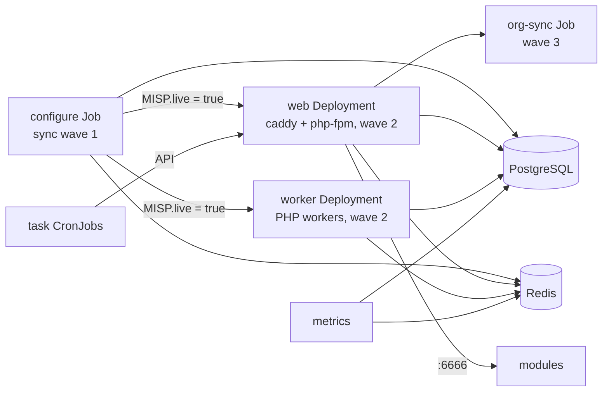

# Architecture

## TL;DR

- The `configure` Job is the only place that touches the schema and the settings; web and
  worker pods wait for it and then start in seconds, in any number.
- A pod of a new image version serves only once the Job has configured that version, whatever
  tool applies the chart.
- Web and worker scale freely: sessions live in Redis, attachments on a shared claim or S3.

## Roles

The `misp-container` image serves six roles, each a module that starts as `python3 -m
misp_container.<role>`. Every role first renders `app/Config` from this image's MISP,
`settings.yaml` and env into an emptyDir of its own. It imports the GPG key and copies the
server certificates from their Secrets, then does its own job:

| Role | Module | Runs as | Does |
|------|------------|---------|------|
| configure | `configure` | Job, once per release revision | Schema import or migration, settings, admin user, GPG, auth plugins. Sets `MISP.live=true` last |
| web | `web` | Deployment, scalable | Waits for `MISP.live=true`, then runs PHP-FPM on 9002 behind caddy on 8080 |
| worker | `worker` | Deployment, scalable | Waits for `MISP.live=true`, then runs the workers of the `default`, `prio`, `email`, `update` and `cache` queues and starts each one again when it exits |
| org-sync | `sync` | Job, once per release revision, after web serves | Applies `orgs.yaml` through the API |
| metrics | `metrics` | Deployment | Prometheus exporter on 9191 |
| task | `task` | CronJobs (component `cronjobs`) | All periodic work, through MISP's console in the CronJob's pod, see [Periodic tasks](kubernetes.md#periodic-tasks). MISP's own scheduler never runs |

The workers take their jobs from Redis, and nothing connects to them. MISP's worker page and
its diagnostics expect supervisord beside the web server, so they show no workers:
`MISP.manage_workers` is off. The metrics exporter shows the job queues ([metrics.md](metrics.md)).

## The configure Job

The Job is the only place that touches the schema and the settings. Web and worker pods
never do, so they start in seconds and any number of them can run.

1. Refuses to run with a placeholder secret, a missing or short `SECURITY_SALT`, or an empty
   `MISP_UUID`.
2. Takes the database advisory lock `misp_configure` (a concurrent org sync waits on it).
3. Imports MISP's PostgreSQL baseline (`POSTGRESQL.sql`) on an empty database, then runs
   `cake Admin runUpdates`.
4. Reads every current setting once, compares with `settings.yaml`, and calls `cake` only for
   the differences: env-driven settings are enforced, and defaults are written once.
5. Creates or updates the admin user, organisation, password and API key; configures GPG and
   the auth plugins.
6. Sets `MISP.live=true`.

The Job is idempotent: run it as often as you like.

## Startup and footprint

Measured on MISP `3.0_wip` at commit 8888b98 on a podman machine (arm64, six cores):

| What | Time |
|------|------|
| Configure Job on an empty database: schema import, `runUpdates`, about 150 settings, admin user, GPG | 22 s |
| Configure Job on a configured instance | 1 to 3 s |
| Web or worker pod, from start to serving, once the Job has run | 1 s |

Idle memory per container, after the first start:

| Container | Idle RSS | Note |
|-----------|----------|------|
| web | 42 MB | Grows with the PHP-FPM children under load (`PHP_FCGI_CHILDREN`, `PHP_MEMORY_LIMIT` per request) |
| worker | 380 MB | 21 PHP worker processes (`NUM_WORKERS_*`) |
| modules | 140 MB | |
| metrics | 28 MB | |
| caddy | 11 MB | |
| PostgreSQL | 79 MB | Default `shared_buffers` (128 MB); the chart's component sets 512 MB |
| Redis | 5 MB | `maxmemory` 128 MB |

The chart's pods request 256 MiB for PHP-FPM in a web pod, 512 MiB for a worker pod and
256 MiB for modules, with limits of 4 GiB, 2 GiB and 1 GiB: the requests cover the idle use above, the
limits one large event import or enrichment.

## Rollout order

Ordering does not depend on the tool that applies the chart. The Job records the image
version it configured next to `MISP.live`, and a web or worker pod waits until both match its
own image, so a pod of a new version never serves before its migrations ran. Each release
revision has its own Job, `configure-<revision>`, because the pod template of a Job cannot
change; the upgrade removes the Job of the previous revision.

| Event | What happens |
|-------|--------------|
| First install | The Job imports the schema and configures MISP. Web and worker pods wait (up to 6 minutes, then restart and wait again). |
| Later rollouts | Pods of the old version keep serving while the Job runs MISP's schema updates, as MISP's own updater does on a live instance. Pods of the new version wait for the new Job to record their version, then serve. |
| The Job fails | New pods keep waiting and restarting; old pods keep serving. Read the Job's log, fix the cause, upgrade again. |
| Nothing changed | The Job runs, finds nothing to do, and exits 0 in seconds. |
| Rollback | `helm rollback` runs the Job of the previous revision again: it records its version and the pods of that version serve. A `kubectl rollout undo` alone leaves the pods waiting. |

| Tool | Notes |
|------|-------|
| Helm | Each `helm install` or `helm upgrade` creates the Jobs of its revision and removes those of the previous one. |
| Argo CD | The Jobs are Sync hooks (`configure` in wave 1, the Deployments in wave 2, `org-sync` in wave 3), recreated on every sync. Argo CD renders the chart as revision 1 every time, so the hook, not the name, makes the new Job. The Deployments do not even roll before the Job succeeded. |
| Flux | A HelmRelease upgrades the release as `helm upgrade` does. |

## Scaling

| Deployment | Replicas | Notes |
|------------|----------|-------|
| web | any | Sessions live in Redis; org logos and attachments are on a shared claim |
| worker | any | Redis `BRPOP` gives each job to one worker. A stopping worker gets `WORKER_STOP_GRACE` seconds (default 300) to finish, and the pod's termination grace period is 30 s more; a job on a worker that dies is lost |
