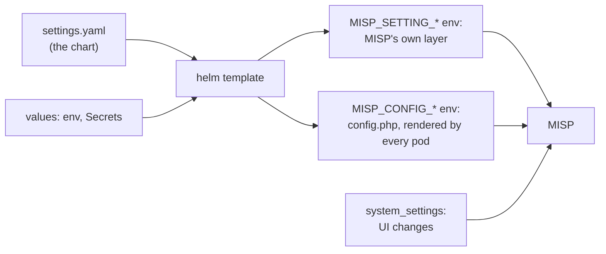

# Configuration

## TL;DR

- The settings the repository brings win over any change made in MISP's UI or API: the state
  of MISP is defined in git. `deploy/chart/files/settings.yaml` holds them; every setting has
  an env var derived from its name, and a value in the chart's `env` replaces the file's.
- A setting the repository does not set may change in the UI; the metrics exporter and the
  configure log report each one.
- The variables every deployment sets are in the [README](../README.md#essential-variables).
- MISP runs on PostgreSQL, which `DB_*` names; the auth plugins switch on with one variable
  each; every pod logs to stdout and stderr, as JSON or text.

## Settings



`deploy/chart/files/settings.yaml` holds the settings this repository defines, in groups. Every
setting has an env var derived from its name:

```
MISP.redis_host        ->  MISP_REDIS_HOST
Plugin.S3_bucket_name  ->  PLUGIN_S3_BUCKET_NAME
```

A value in the chart's `env` (or, for a secret, in a Secret) replaces the file's. The chart
passes every setting to MISP as `MISP_SETTING_<Category>__<key>`, MISP's own environment
layer:

| Source | MISP reads it | A change in the UI or API |
|--------|---------------|---------------------------|
| `MISP_SETTING_*` env, every setting of the repository | Last, so it wins | Refused |
| `system_settings` table | After config.php | Saved here, for a setting the repository does not set |
| `config.php`, rendered by every pod | First | None |

`config.php` holds what MISP reads before its environment layer: the `minimum_config` and
`db_enable` groups, `s3` while `PLUGIN_S3_BUCKET_NAME` is set, and the auth plugins.

A MISP setting that `settings.yaml` does not list takes its `MISP_SETTING_*` name in the
chart's `env` directly: `MISP_SETTING_MISP__welcome_text_top: Welcome` sets
`MISP.welcome_text_top`. Once set there, the UI can no longer change it.

Some env vars fill others unless those are set explicitly (the `derived` list of
`settings.yaml`): `MISP_REDIS_*` fills the background-job and ZeroMQ Redis settings,
`MISP_BASEURL` the external and REST client base URLs, `ADMIN_EMAIL` `MISP.email` and through
it `MISP.contact` and `GnuPG.email`, and `ADMIN_ORG` `MISP.org`, the hosting organisation in
e-mail subjects and STIX 1 exports.

Each configure run deletes the database rows of the settings the repository carries, and logs
a warning for every other row that a person changed, with who and when from MISP's log. The
metrics exporter reports the same settings as `misp_setting_manual`
([metrics.md](metrics.md)): move each into git, or undo it.

Container-level defaults (database and Redis hosts, PHP limits, worker counts) are in
`deploy/chart/files/base.env`, which the chart reads.

## Database

MISP runs on PostgreSQL.

| Variable | Description |
|----------|-------------|
| `DB_HOST`, `DB_PORT` | The server: `postgres` and 5432, the Service of the postgres component |
| `DB_NAME`, `DB_USER`, `DB_PASSWORD` | The database and its owner (`misp-db` holds the credentials, or the Secrets that the chart's `connectionSecrets` value names) |
| `DB_SSLMODE` | TLS in libpq's terms: `disable`, `prefer` (the default: TLS when the server offers it), `require`, `verify-ca` or `verify-full`. Only the two verify modes check the server's certificate |
| `DB_SSLROOTCERT` | The CA certificate of the verify modes; the chart's `databaseCA` value mounts it and sets this. `verify-ca` needs it; without it, `verify-full` checks against the system's CAs |

The database must exist with UTF8 encoding and be owned by the user; the configure Job loads
MISP's baseline into it. An external PostgreSQL such as CloudNativePG, Percona or StackGres
needs only the `DB_*` values ([kubernetes.md](kubernetes.md#external-postgresql-and-redis)).
Keep a connection pooler in front of it in session mode, as StackGres's is by default: the
configure Job holds an advisory lock for its whole run. The migrate Job copies a
MySQL or MariaDB MISP into it ([migration.md](migration.md)). The On Demand correlation
engine needs MySQL, so it is not available.

## HTTPS

Caddy serves plain HTTP on 8080, for an ingress, a Gateway or a load balancer in front, which
terminates TLS.

## Authentication plugins

MISP's auth plugins read their configuration from `config.php`, so their settings are groups
in `settings.yaml` that every MISP pod renders into `config.php` when the plugin's switch is on. The documented
short names below are aliases of the derived ones (the `aliases` of `settings.yaml`:
`OidcAuth.provider_url` is `OIDCAUTH_PROVIDER_URL` as well).

| Switch | Group | Plugin |
|--------|-------|--------|
| `OIDC_ENABLE=true` | `oidc` | `OidcAuth`: OpenID Connect |
| `LDAPAUTH_ENABLE=true` | `ldap` | `LdapAuth`: LDAP bind with a reader account |
| `CUSTOM_AUTH_ENABLE=true` | `custom_auth` | `Plugin.CustomAuth_*`: a header from the proxy, no lookup. These settings reach MISP's environment layer like any other; the `CUSTOM_AUTH_*` names below are aliases of the derived ones |

### OpenID Connect

| Variable | Setting | Default |
|----------|---------|---------|
| `OIDC_PROVIDER_URL` | `OidcAuth.provider_url` | required |
| `OIDC_CLIENT_ID`, `OIDC_CLIENT_SECRET` | `OidcAuth.client_id`, `client_secret` | required; the secret belongs in `misp-app` |
| `OIDC_ISSUER` | `OidcAuth.issuer` | the provider URL |
| `OIDC_ROLES_PROPERTY` | `OidcAuth.roles_property` | `roles`: the claim with the user's roles |
| `OIDC_ROLES_MAPPING` | `OidcAuth.role_mapper` | `{}`: JSON, IdP role to MISP role id or name, first match wins. A user with no matching role is refused |
| `OIDC_DEFAULT_ORG` | `OidcAuth.default_org` | organisation id, UUID or name when the IdP sends none |
| `OIDCAUTH_ORGANISATION_PROPERTY` | `OidcAuth.organisation_property` | `organization`: the claim with the user's organisation. A UUID or a list of names, such as Keycloak's organisation aliases, only finds one; a single name also creates a missing one ([org-sync.md](org-sync.md#keycloak)) |
| `OIDCAUTH_ORGANISATION_UUID_PROPERTY` | `OidcAuth.organisation_uuid_property` | `organization_uuid`: with a name in the claim above, the UUID to find the organisation by; OidcAuth renames it to that name |
| `OIDC_SCOPES` | `OidcAuth.scopes` | `profile,email` |
| `OIDC_MIXEDAUTH` | `OidcAuth.mixedAuth` | `false`: every login goes to the IdP. `true` keeps the password form and adds a button |
| `OIDC_LOGOUT_URL` | `Plugin.CustomAuth_custom_logout` | the IdP's logout URL |
| `OIDC_AUTH_METHOD`, `OIDC_CODE_CHALLENGE_METHOD` | `authentication_method`, `code_challenge_method` | `client_secret_post`, `S256` |
| `OIDC_DISABLE_REQUEST_OBJECT` | `OidcAuth.disable_request_object` | `false`: `true` for an IdP that refuses signed request objects |
| `OIDC_SKIP_PROXY` | `OidcAuth.skipProxy` | `true`: the IdP is reached directly, not through `Proxy.*` |

The redirect URI is `MISP_BASEURL/users/login`; register it at the IdP. Every other
`OidcAuth.*` key in `settings.yaml` (offline access, user validity checks, email linking)
takes its derived env var.

### Keycloak

In Keycloak:

1. Create a confidential OpenID Connect client for MISP with the standard flow on and the
   redirect URI `MISP_BASEURL/users/login`. Keep the default client scopes `roles` and
   `organization`: the organisation mapper of step 4 emits only while that scope is on.
2. Create a client role on it for each MISP role, such as `read-only`, `user`, `publisher`,
   `org-admin` and `admin`, and grant them to users or groups.
3. Add a mapper of type User Client Role for the client: claim name `roles`, multivalued, in
   the ID token. The `roles` scope puts client roles in the access token only, which OidcAuth
   does not read.
4. Make each team a Keycloak organisation with its users as members. Add a mapper of type
   Organization Membership to the client: claim name `misp_organisation`, multivalued, in the
   ID token, with the organisation's id, attributes and domain off. The claim then lists the
   alias of the user's organisation, and OidcAuth puts the user in the MISP organisation of
   that name ([org-sync.md](org-sync.md#keycloak)). The realm's own `organization` claim can
   hold a map of ids and attributes, which OidcAuth cannot read; this one stays a plain list.

In MISP:

| Variable | Value |
|----------|-------|
| `OIDC_ENABLE` | `true` |
| `OIDC_PROVIDER_URL` | `https://<keycloak>/realms/<realm>` |
| `OIDC_CLIENT_ID`, `OIDC_CLIENT_SECRET` | The client's ID and secret; the secret belongs in `misp-app` |
| `OIDC_ROLES_MAPPING` | The client roles, highest first: `{"admin": "admin", "org-admin": "Org Admin", "publisher": "Publisher", "user": "User", "read-only": "Read Only"}`. OidcAuth takes the first match, so a user gets the highest role held |
| `OIDCAUTH_ORGANISATION_PROPERTY` | `misp_organisation` |
| `OIDC_DEFAULT_ORG` | Optional: the organisation of a user in no Keycloak organisation. Empty refuses that login |
| `OIDCAUTH_OFFLINE_ACCESS` | Optional: `true` for the `check-user-validity` task. Users then need the realm role `offline_access`, which Keycloak's default roles hold |

A user in several Keycloak organisations lands in any one of them. A user whose organisation
has no MISP organisation of that name cannot log in. The accounts of a migrated instance need
two more settings ([migration.md](migration.md#keycloak)). The integration suite logs in through a
Keycloak with this setup (`tests/keycloak-realm.json`), then checks that an org sync run
leaves the account enabled.

### Header authentication

| Variable | Setting | Default |
|----------|---------|---------|
| `CUSTOM_AUTH_HEADER` | `Plugin.CustomAuth_header` | `X_FORWARDED_EMAIL` |
| `CUSTOM_AUTH_USE_HEADER_NAMESPACE`, `CUSTOM_AUTH_HEADER_NAMESPACE` | `Plugin.CustomAuth_use_header_namespace`, `header_namespace` | `true`, `HTTP_` |
| `CUSTOM_AUTH_REQUIRED` | `Plugin.CustomAuth_required` | `false`: without the header, the login page |
| `CUSTOM_AUTH_NAME` | `Plugin.CustomAuth_name` | `External Authentication` |
| `CUSTOM_AUTH_DISABLE_LOGOUT` | `Plugin.CustomAuth_disable_logout` | `false` |
| `CUSTOM_AUTH_ONLY_ALLOW_SOURCE` | `Plugin.CustomAuth_only_allow_source` | unset: the proxy's URL, when only it may log users in |
| `CUSTOM_AUTH_CUSTOM_PASSWORD_RESET`, `CUSTOM_AUTH_CUSTOM_LOGOUT` | `Plugin.CustomAuth_custom_password_reset`, `custom_logout` | unset: the external system's URLs |

### LDAP

`LDAPAUTH_LDAPSERVER`, `LDAPAUTH_LDAPDN`, `LDAPAUTH_LDAPREADERUSER`, `LDAPAUTH_LDAPREADERPASSWORD`
are required; `LDAPAUTH_LDAPSEARCHFILTER`, `LDAPAUTH_LDAPDEFAULTORGID`, `LDAPAUTH_LDAPDEFAULTROLEID`,
`LDAPAUTH_LDAPROLEFIELD` and the rest of the `ldap` group follow the plugin's README.

## Logging

Every pod writes its log to stdout and stderr and keeps no log file. `LOG_FORMAT` selects the
line format: `json` (the `base.env` default: one JSON object per line, for a log collector)
or `text` (coloured on a terminal).

| Source | Reaches the output as | Format |
|--------|-----------------------|--------|
| The entrypoints, the configure Job, org sync, tasks, metrics | `time`, `level`, `context`, `message` (and `exception`) | `LOG_FORMAT` |
| MISP's own log (CakeLog: job starts and ends, exceptions, warnings) | the same fields, `context` `misp` | `LOG_FORMAT` |
| Files MISP appends to directly (`server-sync.log`, `workflow-execution.log`, `exec-errors.log`, `kafka.error.log`, `fatal_error.log`, `mispzmq.log`, `mispzmq.error.log`) | one line per file line, `context` `misp:<file>`; a file is emptied past 10 MB | `LOG_FORMAT` |
| PHP errors and warnings in web pods | PHP's own line, through PHP-FPM | text |
| PHP-FPM itself | FPM's own line | text |
| Caddy access log | Caddy's own JSON | JSON |
