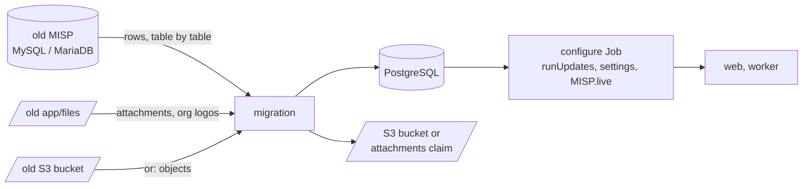

# Migrating an existing MISP instance

The migration copies an existing MISP database (MySQL or MariaDB: the official misp-docker,
a VM, a bare-metal install) into this deployment's PostgreSQL, and copies the attachments
into this deployment's store: its S3 bucket, or the attachments volume. The configure Job
then configures the copy as on any release upgrade.

## TL;DR

1. Read `Security.salt`, `Security.encryption_key` and `MISP.uuid` from the old instance
   (`config.php` or `system_settings`) into `misp-app` and `misp-env`. The migration refuses
   to run when a value it can read on the source differs.
2. Give the migration the source connection (`migrate.secret`) and, to copy attachments, a
   mounted copy of the old `MISP.attachments_dir` (`app/files` by default) or the old S3
   bucket (`MIGRATE_SOURCE_S3_*`). A source on an older MISP release than this image's needs
   `MIGRATE_SOURCE_UPGRADE=true` and a restored copy of its database (see
   [An older source](#an-older-source)).
3. Set the old instance read-only (`MISP.live=false`), then run the copy before the first
   configure run: with the `migrate` component on, the chart runs it as an init container of
   the configure Job. The copy refuses a target that holds anything else (see
   [The target](#the-target)).
4. Switch the component off once the copy has succeeded. Users log in again;
   terms and the GPG keyring are copied by hand.
5. With Keycloak, name each migrated organisation's team after its Keycloak organisation's
   alias, and turn on email linking and unblocking (see [Keycloak](#keycloak)).



## What the migration does

| Step | What happens |
|------|--------------|
| Identity | `MISP.uuid` and the salt and key, where the source stores them, must equal this deployment's values (exit 4) |
| Target | see [The target](#the-target) |
| Schema | this image's PostgreSQL baseline, then `cake Admin runUpdates` on it. The source must be at the same `db_version` and ledger state (exit 5); `MIGRATE_SOURCE_UPGRADE=true` upgrades the source first, with `cake Admin runUpgrade` |
| Rows | every table the baseline has, by column name, in multi-row inserts with the table's secondary indexes dropped, then built once; flags become booleans, zero dates become NULL; the id sequences move past the copied ids |
| After | `MISP.live=false` on the copy, so web and worker wait for the configure Job |
| Files | the attachments of `MIGRATE_SOURCE_FILES` or `MIGRATE_SOURCE_S3_BUCKET` into the deployment's bucket or attachments volume, and org logos and custom images onto the volume (see [Attachments](#attachments)) |

The migration holds the configure lock while it copies. A configure Job that starts
meanwhile waits for it, then configures the copy.

| Exit code | Meaning |
|-----------|---------|
| 0 | Copied, or the target holds a copy the migration made, which stays |
| 1 | The copy failed part way, rows, the source's updates or attachments; the target holds a partial copy, run again with `MIGRATE_FORCE=true` |
| 2 | Configuration: no `MIGRATE_SOURCE_HOST`, the source refuses the connection, both attachment sources set, a bucket without an access key, or a bucket the migration cannot list |
| 3 | The target database is not empty and holds no copy the migration made |
| 4 | An identity setting on the source differs from this deployment's |
| 5 | The source schema is not this image's |

The migration counts its runs in the target's `system_settings` row
`misp_docker.runs.migrate`, and the metrics exporter reports them as it does the configure
runs ([metrics.md](metrics.md)).

### The target

The target must hold no tables. `MIGRATE_FORCE=true` drops every table of a target that
holds anything else, such as the fresh install of a deployment that has run once. A copy that
the migration made stays, and the run exits 0, `MIGRATE_FORCE=true` included: this lets the
copy run again on each upgrade and each configure retry while the component is on. Only
`MIGRATE_FORCE=true` with `MIGRATE_REPLACE_COPY=true` drops that copy and copies again.

### An older source

MISP changes its schema between releases, and the copy needs the source at this image's
schema. Restore a dump of the old database into a database of its own, point the migration
at that copy and set `MIGRATE_SOURCE_UPGRADE=true`: the migration runs
`cake Admin runUpgrade` on it, which applies the numbered 2.x updates and converts the
database to MISP 3.0, then copies it. On a large instance the conversion takes hours. Never
point it at the live source with `MIGRATE_SOURCE_UPGRADE=true`, because the upgrade writes to
the database it runs on. A
source at a newer schema than this image is not supported; take the image of the same or a
newer release.

### Attachments

| Source | Target: `PLUGIN_S3_BUCKET_NAME` set | Target: no bucket |
|--------|-------------------------------------|-------------------|
| `MIGRATE_SOURCE_FILES`, a mounted directory | uploaded to the deployment's bucket | copied onto the attachments volume |
| `MIGRATE_SOURCE_S3_BUCKET`, the old bucket | copied bucket to bucket, one object at a time through `/tmp` | downloaded onto the attachments volume |
| neither | no attachments copied | same |

MISP keeps an attachment at `<event id>/<attribute id>` with a suffix for derived files, and
the attachments of a proposal under `shadow/`. A source with `MISP.attachments_bucketed`
also has a `bucket_<n>/` level on disk; the migration drops it, as MISP does on S3 and in
this image's volume. The migration lists both buckets before it copies the database and
stops there (exit 2) when it cannot. It signs its S3 requests with an access key, and
reaches an AWS-compatible store path-style at its endpoint, as MISP does.

When `MIGRATE_SOURCE_FILES` is the old `app/files` and the target is the attachments volume,
the migration also copies the org logos (`img/orgs`) and custom images (`img/custom`) there,
where every pod reads them. Other files in the old directory (taxonomies, scripts) ship in
the image and are left out. With the attachments in S3, MISP keeps the images in each pod,
and the migration copies none.

## Configuration

| Variable | Meaning |
|----------|---------|
| `MIGRATE_SOURCE_HOST`, `MIGRATE_SOURCE_PORT` | The source database (port 3306 by default) |
| `MIGRATE_SOURCE_NAME`, `MIGRATE_SOURCE_USER`, `MIGRATE_SOURCE_PASSWORD` | Database (`misp` by default) and a user that can read it, and write it with `MIGRATE_SOURCE_UPGRADE` |
| `MIGRATE_SOURCE_TLS` | `true` for a TLS connection, checked against the system CA bundle |
| `MIGRATE_SOURCE_UPGRADE` | `true` upgrades the source to this image's MISP before the copy (`cake Admin runUpgrade`) |
| `MIGRATE_SOURCE_FILES` | A mounted copy of the source's attachments directory |
| `MIGRATE_SOURCE_S3_BUCKET`, `MIGRATE_SOURCE_S3_ENDPOINT`, `MIGRATE_SOURCE_S3_REGION` | The source's bucket, instead of `MIGRATE_SOURCE_FILES`; the endpoint of an AWS-compatible store, empty for AWS; the region (`eu-west-1` by default, as in MISP) |
| `MIGRATE_SOURCE_S3_ACCESS_KEY`, `MIGRATE_SOURCE_S3_SECRET_KEY` | A key that can list and read the source bucket |
| `MIGRATE_SOURCE_S3_VALIDATE_CA`, `MIGRATE_SOURCE_S3_CA` | `false` skips the TLS check; a CA bundle for it |
| `MIGRATE_FORCE`, `MIGRATE_REPLACE_COPY` | See [The target](#the-target) |

The target is the deployment's own `DB_*` connection, and for attachments its own
`PLUGIN_S3_*` settings (the key needs write access to the bucket) or its attachments volume.

## Kubernetes

1. Put the source connection in `migrate.secret`, or supply a Secret `misp-migrate` with the
   keys of `deploy/chart/files/secrets-migrate.env` when `secrets.create` is `false`.
2. Set `migrate.enabled: true`. To copy attachments from the old bucket, set
   `MIGRATE_SOURCE_S3_*`. To copy them from a directory, give the copy a volume for the old
   files and set `MIGRATE_SOURCE_FILES` to its mount path:

   ```yaml
   migrate:
     enabled: true
     secret:
       MIGRATE_SOURCE_HOST: old-misp-db.example.com
       MIGRATE_SOURCE_PASSWORD: ...
       MIGRATE_SOURCE_FILES: /mnt/source
     volumes:
       - {name: source-files, persistentVolumeClaim: {claimName: old-misp-files}}
     volumeMounts:
       - {name: source-files, mountPath: /mnt/source, readOnly: true}
   ```

3. Install or upgrade. The copy runs as the init container `migrate` of the configure Job,
   so the configure step starts on the copy. Argo CD runs it in the configure Sync hook, in
   wave 1. A failed copy is not retried: read the log of the init container, fix the cause,
   upgrade again.

   ```bash
   kubectl -n misp logs -l app.kubernetes.io/name=configure -c migrate
   ```

4. Switch the component off after the first successful copy.

Onto a deployment that has run once, set `MIGRATE_FORCE=true` in `migrate.secret` as well.
The web and worker pods keep running; they answer with errors while the copy runs, and MISP
shows itself as offline (`MISP.live=false`) until the configure Job has configured the copy.

With the `networkPolicy` component the configure pod may reach the
source on port 3306 and S3 on 443, in the cluster or outside it, while `migrate` is on;
another port needs a change to the template.

## Files copied by hand

| Data | Where it goes |
|------|---------------|
| Server certificates | The `misp-certs` Secret (see [kubernetes.md](kubernetes.md#secrets)) |
| Terms | Nothing carries them: `app/files/terms` is a volume of each pod, so a terms file uploaded in the UI stays on the pod that took it |
| GPG keyring | The `misp-gnupg` Secret from the old `private.asc` export; or a new key, re-exported to sync partners |
| Attachments already on S3 | Nothing: point `PLUGIN_S3_*` at the same bucket, or copy them to a new one with `MIGRATE_SOURCE_S3_*` |

Sessions, the Redis cache, the CakePHP cache and log files are not copied.

## Cut-over

The old instance stays read-only while the migration runs, so time a trial run against a
copy of the source first. The migration logs the conversion to MISP 3.0, each table and each
index it builds. On a large instance the conversion takes hours.

1. Set `MISP.live=false` on the old instance so no event changes during the copy.
2. Run the migration and the first sync. Check the copy: log in, open an event with an
   attachment, list the sync servers.
3. Move the DNS name or the ingress to the new instance.
4. To go back, point the name back at the old instance and set `MISP.live=true` there. The
   migration never writes to the old database: `MIGRATE_SOURCE_UPGRADE` runs on a copy.

## After the copy

- **Passwords and authkeys** work as before when the salt and encryption key are the old
  ones. The configure Job sets the e-mail, password and API key of user 1 from `ADMIN_*` on
  every run. On a copy, user 1 is the old instance's user 1.
- **Settings** stored in the old database are kept, except those the repository carries:
  the configure Job deletes their rows, and MISP takes them from its environment layer
  ([configuration.md](configuration.md#settings)). The exporter reports each kept one in
  `misp_setting_manual`: move it into the chart's values, or delete it in MISP.
- **A new GPG key** must be re-exported to sync partners.

### Keycloak

A migrated account has no OIDC subject yet, so OidcAuth and the org sync treat it as a local
account until its first Keycloak login ([configuration.md](configuration.md#keycloak)):

1. In `orgs.yaml`, give each migrated organisation a team with its old UUID and, as its name,
   the alias of its Keycloak organisation. The org sync renames the organisation and keeps its
   id, its events and its users.
2. Set `OIDCAUTH_ALLOW_EMAIL_LINKING=true` and `OIDCAUTH_UNBLOCK=true`. The org sync
   disables each migrated account that `orgs.yaml` does not name. At the first Keycloak login,
   OidcAuth links the account by its email, which Keycloak must hold as verified, enables it
   again and moves it to the team of the user's Keycloak organisation.

With `OIDCAUTH_UNBLOCK=true` Keycloak decides who logs in: a Keycloak login also enables an
account that an admin disabled in MISP. Leave `OIDCAUTH_REQUIRE_EMAIL_VERIFIED` at `true`:
where people can change their own email in Keycloak, an unverified email would link one
person's login to another's account. An account that used header authentication in the old
instance keeps its external auth, and the org sync leaves it enabled. The migration suite runs
both steps on its copy.

## What MISP 3.0 no longer has

| What | In 3.0 |
|------|--------|
| The STIX 1 export | Needs `MISP.org`, which `ADMIN_ORG` fills |
| The HIDS, OpenIOC and Suricata exports | Gone |

## Migrating from official misp-docker

The official image runs MISP 2.5, so its database is an older source: set
`MIGRATE_SOURCE_UPGRADE=true` ([An older source](#an-older-source)). Other differences to
account for: the official image runs as `www-data` (33), this one as UID 1000, so copied files
need `chown`; `app/files` ships in this image and only the attachments, `app/files/scripts/tmp`,
`certs`, `terms`, `img/orgs` and `img/custom` are volumes; workers run in their own container.
