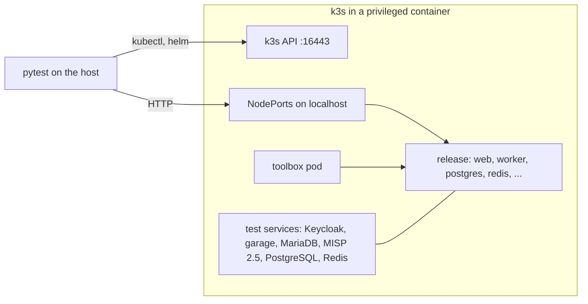
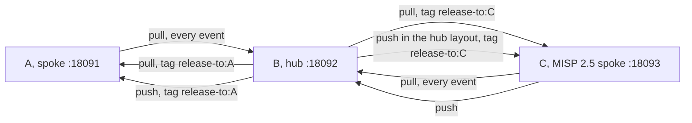

# Testing

## TL;DR

Unit tests on the Python library and the chart's renders, an upstream guard that checks the MISP in the image against what this repository patches or depends on, and four stack suites in pytest (`tests/e2e/`). Each stack suite installs the Helm chart on its own k3s cluster in podman: an integration suite on one release, a hub-spoke sync suite on two releases and a MISP 2.5 partner, a migration suite that imports a MISP 2.5 database on MariaDB into PostgreSQL through the chart's migrate component, and a lifecycle suite that upgrades from the newest release, runs the CronJobs, upgrades and rolls back. A smoke test checks any live MISP through its API.

```bash
mise run test                # unit tests, the chart lint and every chart render validated against the schemas
mise run build               # the three images under the chart's appVersion, or MISP_IMAGE_TAG
mise run test-integration    # the upstream guard, then the integration suite (~4min)
mise run test-sync           # hub-spoke sync with 2 releases and a MISP 2.5 partner (~6min)
mise run test-migration      # a MISP 2.5 database on MariaDB into PostgreSQL (~4min)
mise run test-lifecycle      # upgrade from the newest release, helm test, CronJobs, upgrade, rollback (~6min)
mise run smoketest https://misp.example.com   # a live MISP; asks for an API key
mise run test-all            # the unit tests and every stack suite
```

A stack suite builds the images first. Pass `--skip-build` to reuse the images under the tag and `--keep` to leave the cluster running.

## Unit tests

Tests of the Python entrypoint library (`files/misp_container/`), the scripts and the chart.

<!-- generated: unit-tests -->
| Module | Tests |
|---|---|
| `test_admin.py` | Unit tests for admin helpers: every value reaches SQL as a parameter. |
| `test_agents_md.py` | AGENTS.md is what scripts/generate_agents_md.py makes of the tree. |
| `test_apply_patches.py` | The patches of patches/ and their applier (scripts/apply_patches.py), on real git trees. |
| `test_chart.py` | The Helm chart renders what the code and the release expect (helm template, no cluster). |
| `test_chart_schema.py` | helm lint, and every render of the chart validated against the Kubernetes and CRD schemas. |
| `test_check_upstream.py` | Unit tests for the upstream guard (scripts/check_upstream.py). |
| `test_config.py` | Unit tests for the config diff engine. |
| `test_config_php.py` | Unit tests for config.php rendering from settings.yaml. |
| `test_configure.py` | Unit tests for the configure step's identity and secret checks. |
| `test_db.py` | Unit tests for the database layer and housekeeping (no PostgreSQL needed). |
| `test_docs.py` | The docs name only what the code has. |
| `test_env.py` | Unit tests for environment variable handling. |
| `test_init.py` | Unit tests for init container logic (file operations, no containers needed). |
| `test_log.py` | Unit tests for the container log formats (LOG_FORMAT json or text). |
| `test_logrelay.py` | Unit tests for the log relay (misp_container.logrelay). |
| `test_metrics.py` | Unit tests for the Prometheus metrics exporter. |
| `test_migrate.py` | Unit tests for the migration Job (misp_container.migrate). |
| `test_release.py` | Unit tests for the release tool (scripts/release.py): the next tag and chart version. |
| `test_s3.py` | Unit tests for the minimal S3 client (misp_container.s3). |
| `test_sync.py` | Unit tests for the org sync engine. |
| `test_task.py` | Unit tests for the periodic task runner. |
| `test_update_settings.py` | Unit tests for the settings catalogue updater (scripts/update_settings.py). |
| `test_worker.py` | Unit tests for the worker supervisor (misp_container.worker): the programs, restarts and stop. |
<!-- end generated -->

Run with: `mise run test` or `PYTHONPATH=files python -m pytest tests/ -v --ignore=tests/e2e`

**Render check** (`test_chart_schema.py`): runs `helm lint --strict`, renders the chart with
the default values, with each component on, with every component on, and with supplied
Secrets, attachments in S3 and a workflow CronJob. It validates each render with
`kubeconform -strict` against the Kubernetes schemas and, for the HTTPRoute, the copy of the
datree CRD catalog in `tests/schemas/`. It needs `helm` and `kubeconform` (`mise install` in
the repository); without `kubeconform` the render tests skip, and in CI they fail.
`test_chart.py` checks what the renders hold.

## Upstream guard

`e2e/test_upstream.py` runs `scripts/check_upstream.py` in one container of the main image,
with the repository mounted, and reports each check as one test. A check reads MISP's own
files and fails when MISP changed something this repository patches or depends on;
DEVELOPING.md lists the checks. A failure names the change, the MISP file and the file of
ours to revisit. No cluster starts, so the guard reports even when MISP no longer starts.

`mise run test-integration` and the CI job `integration` run it before the integration suite;
`python -m pytest tests/e2e/test_upstream.py` runs it alone.

## How a stack suite runs



1. The suite builds the images (`scripts/build.py`) unless `--skip-build`, starts a k3s cluster
   (`e2e/cluster.py`) and copies the three images into its containerd.
2. It applies the test services of `k3s/*.yaml` and NodePorts for the ports the host reaches,
   then installs the chart with `k3s/values.yaml` and the suite's own values (`e2e/stack.py`).
3. Tests call MISP over HTTP through the NodePorts, and run commands in the pods with
   `kubectl exec`. One-off commands, such as an org sync, a migration, a task or the browser's
   side of a Keycloak login, run in the toolbox: a pod from the pod template of the release's
   configure Job, so with its image, env and mounts.
4. After the module the cluster goes, unless `--keep`.

| Piece | Does |
|-------|------|
| `e2e/cluster.py` | The `Cluster` class: k3s in a container, its kubeconfig, the image copy, kubectl, helm, the log dump |
| `e2e/stack.py` | The `Release` class: install, upgrade and rollback with the waits for the configure Job, the rollouts and the org-sync Job; scale; `exec` in a workload; SQL through the image's db layer; logs; the toolbox; HTTP to MISP |
| `e2e/manifests.py` | Loads the test services of `k3s/*.yaml`, with their settings as a ConfigMap, the NodePorts and the toolbox pod |
| `e2e/conftest.py` | `--skip-build`, `--keep`, `--url` and `--key` for the smoke test, a fixture that tells a module whether one of its tests failed, and the log dump at a module's first failure |
| `k3s/values.yaml` | The values every suite starts from: the postgres and redis components, test secrets, a ReadWriteOnce attachments claim |
| `k3s/oidc.yaml` | OIDC through the test Keycloak, for the integration and migration suites |

k3s runs under `K3S_CMD`. By default that is podman on the machine's rootful connection
(`podman-machine-default-root`) on macOS, because k3s needs privileges that rootless podman
does not give, and `CONTAINER_CMD` elsewhere. `CONTAINER_CMD` (podman by default) holds the
images. The suites publish the same ports on localhost, so run one at a time.

A suite is one module. Module fixtures run each step once and hand its result on; the tests
run in file order. At a module's first failure the state and the log of every pod outside
`kube-system` go to `$TMPDIR/<suite>-first-failure-cluster-logs.txt`, and after a failure the
teardown writes `$TMPDIR/<suite>-cluster-logs.txt`. CI uploads them with the JUnit report.

## Integration suite

One release of the chart, checked feature by feature, with Keycloak for the OIDC login, garage
for the attachments in S3, and PostgreSQL and Redis outside the chart, as a database operator
runs them (`k3s/external.yaml`).

| Section | What it verifies |
|-------|------------------|
| Non-root operation | The web and worker pods run as UID 1000; so does the caddy image |
| HTTP / Caddy | Login page, static CSS, root redirect, a forged `X-Forwarded-For` kept out of the audit log |
| Admin user config | Email, password (no forced reset), org name, org UUID, last_pw_change |
| Database settings | DB persistence, setting count, BASE_URL in DB |
| Workers | Each of the five queues runs `NUM_WORKERS_<QUEUE>` workers, no scheduler worker, a killed worker is started again |
| Background jobs | Event publish triggers job, worker completes it (status=4) |
| MISP's Python scripts | STIX 2 and STIX 1 exports |
| PHP-FPM | Listening on port 9002, its php.ini, the built extensions |
| Distribution files and app/Config | taxonomies in the image, bootstrap.php is MISP's default plus the logging block, database.php on the external PostgreSQL with `verify-full`, config.php content and the external Redis |
| External PostgreSQL | The database user is no superuser, a connection without TLS is refused, the server certificate is checked against the CA of `databaseCA` |
| GPG | The key of the `misp-gnupg` Secret, which the suite makes with the image's `gpg`, imported into the web pod's homedir |
| MISP API | Version endpoint, event create via API |
| Warm restart | A second run over the database groups loads the settings and changes none |
| Defaults version | The configure step records the image version the pods wait for |
| S3 attachment storage | Garage S3 bootstrap, upload, download, bucket verification |
| Custom auth | Header login (200), no-header redirect (302) |
| OIDC login | Redirect to Keycloak, its login form, the callback, the user's email, the highest client role, the team of the user's Keycloak organisation, mixed auth |
| Task runner | Every scheduled task through MISP's console in the toolbox; `sharing-group-blueprints` without blueprints; `periodic-summary` and `check-user-validity` |
| Org sync | Org/user/tag/server creation, server authkey (DB verify), sync user authkey prefix, taxonomy enable, disabled user, an unnamed local user disabled and the OIDC user left enabled, a break-glass password login, custom warninglist create/update, warm run idempotency |
| Metrics exporter | Endpoints, core metrics, no scrape errors, a job that waits in `misp_jobs_queued` while the workers are scaled to none, `misp_scheduled_tasks_enabled` |
| MISP modules | Enrichment through the modules Service |
| Logging | JSON lines from configure and none in text, MISP's own log in the web and worker output once, no CakeLog files on disk, the relay forwarding `server-sync.log`, every log file MISP wrote in web and worker relayed |
| Multi-replica web | The configure Job ran once, two web replicas serve without configuring |
| Settings | Every MISP setting curated or catalogued, no rejected `cake` setting |

**Files:**
- `e2e/test_integration.py` -- the suite, in the order above; later sections use the state earlier ones leave
- `k3s/keycloak.yaml`, `keycloak-realm.json` -- Keycloak and its realm: the MISP client with its roles and the `roles` mapper, an organisation, and a user in it
- `k3s/garage.yaml`, `e2e/garage.py` -- garage, and its layout, keys and buckets through the admin API
- `e2e/keycloak.py` -- a Keycloak login through MISP, run in the toolbox; the migration suite uses it too
- `k3s/external.yaml`, `k3s/postgres-tls.yaml`, `k3s/external-redis.yaml` -- PostgreSQL that takes password logins over TLS only, with its Secrets in the shape of the Percona operator's and a certificate that openssl in its image makes, and Redis with a password

Run with: `mise run test-integration`

## Lifecycle suite

`e2e/test_lifecycle.py` takes the chart from its install to a rollback. Each step must pass:

1. The newest release of this major version, other than HEAD's own tag, installs from GHCR
   with its own images, and the smoke test passes. The step skips without such a release, and
   when the release has no image for the node's architecture.
2. This tree's chart and images upgrade it, or install fresh. The smoke test and `helm test`
   pass.
3. Two tasks (`update-noticelists`, `periodic-summary`) and a housekeeping run
   (`housekeeping-jobs`), each started from its CronJob, succeed. The configure Job writes
   JSON lines only.
4. An upgrade with a changed value runs a new configure Job, removes the old one and rolls the
   web pods; the smoke test passes.
5. `helm rollback` to the revision before runs its configure Job again, removes the upgrade's,
   restores the value and rolls the web pods; the smoke test and `helm test` pass.

Run with: `mise run test-lifecycle`

## Hub-spoke sync suite

MISP server-to-server synchronisation between isolated instances: two releases of this
tree's chart and a partner on MISP 2.5, on one cluster.

**Stack:** the spoke A and the hub B, each a release with the postgres and redis components in
the namespace `a` or `b`, and the spoke C in the namespace `c`: MISP 2.5.50 from the MISP
project's own images (`misp-core` and `misp-nginx`, pinned by digest) on MariaDB and Redis
(`k3s/misp-25.yaml`, `k3s/mariadb.yaml`). Each release sets its admin key from `ADMIN_KEY`.
The org sync in each release's toolbox configures A and B. C gets its sync user and its server
for B through its API, because the org sync writes authkeys into PostgreSQL. The instances
reach each other at `http://web.a:8080`,
`http://web.b:8080` and `http://nginx.c:8080`.



| Phase | What it verifies |
|-------|------------------|
| Setup | All instances ready; A and B configured through the org sync, C through its API |
| Pull (unfiltered) | B pulls the event from A and the one from C |
| Tagging | B tags it release-to:A, and creates one event tagged release-to:A and one release-to:C |
| Pull (tag-filtered) | A gets the release-to:A event, not the release-to:C one; C gets the release-to:C event, not the release-to:A one |
| Push (tag-filtered) | B pushes a tagged event to A; an untagged one stays on B |
| Push from MISP 2.5 | C pushes an event to B |
| Hub layout | A holds no active servers; B pulls from it, then pushes A and C only the events tagged for each |

Pulls and pushes are POSTs; a refused call fails the suite. Before each check the suite waits
until no job on the instance is unfinished.

Run with: `mise run test-sync`

## Migration suite

`e2e/test_migration.py` loads a MISP 2.5 database into MariaDB (`k3s/mariadb.yaml`): MISP's own
`INSTALL/MYSQL.sql` of v2.5.50, fetched from GitHub at its commit, then `migrate-source.sql`
(an org with a user, an admin and a sync user with known authkeys, a sync server, an event
with an attachment). It records the row counts. The source's files, on the claim
`migrate-source`, hold the event's attachment and one attachment in each place MISP keeps one
on disk: flat, under `bucket_<n>/` and under `shadow/`.

The suite installs the chart with the migrate component and `MIGRATE_SOURCE_UPGRADE=true`:
the configure Job's init container converts the source to MISP 3.0 and copies it into
PostgreSQL, with the attachments onto the attachments claim. Every later run of migrate runs
in the toolbox, with the env of the run. The suite checks the refusals (an identity mismatch,
`MIGRATE_FORCE` alone on the Job's own copy, then with `MIGRATE_REPLACE_COPY`). It upgrades
the release with the migrate component off and checks the copy: row counts, both authkeys,
the org, the server, the event, the attachment download, the fixture attachments under
MISP's keys, `MISP.live` set by the configure step, the run record and the id sequences.

On that copy an org sync renames the migrated organisation, whose name holds spaces, to its
Keycloak organisation's alias by its UUID, and disables the migrated account. That account's
first Keycloak login links it by its email, enables it again and lands it in the renamed
organisation. A forced second copy uploads the attachments into an S3 bucket in garage; the
same checks run on it, plus a new attachment that MISP must write to the bucket. A last run
copies that bucket into a second one and compares every key and byte.

**Files:**
- `e2e/test_migration.py` -- the suite; module fixtures carry each step's state to the next
- `migrate-source.sql` -- the rows of the source, on top of MISP's 2.5 schema

Run with: `mise run test-migration`

## Smoke test

`e2e/test_smoke.py` checks a live MISP through its API: the login page, API auth,
the version, `MISP.baseurl` and `MISP.live`, the org, event and user indexes, the enrichment URL, and an event created and deleted. `--url` names
the MISP; without `--key` only the login page is checked; without `--url` the module skips.
The lifecycle suite runs it after each install, upgrade and rollback.

Run with: `mise run smoketest https://misp.example.com`

## CI

GitHub Actions on every push to master, every tag and every pull request:

| Job | Runs |
|-----|------|
| `gate` | Decides what the run does: nothing on a master push whose commit carries a release tag, since the tag run tests and releases that commit; the unit tests only on a draft; no unit tests and no suites on a push to master that merges a pull request, which ran them on the same tree |
| `build` | The three images into the layer cache. The misp image's final stage is built fresh each run, so it carries the current Debian packages |
| `unit` | The unit tests, the chart lint and every chart render validated against the schemas |
| `suite` | The stack suites, one job each, in parallel, each on k3s in docker against the images from `build` (`MISP_IMAGE_TAG=ci`): `integration` (the upstream guard, then the integration suite), `hub-spoke`, `migration` and `lifecycle`. Each uploads its JUnit report and, after a failure, the cluster's logs |
| `scan` | Trivy on the three images, one scan each: CRITICAL and HIGH findings with a fix go to the Security tab, and a CRITICAL one fails the job, which blocks `publish` |
| `ci-ok` | The one required check: fails when a job failed or was cancelled, and on a draft |
| `publish-arm64` | After every other job, on a tag: the arm64 images, on an arm64 runner without the layer cache, to GHCR by digest |
| `publish` | After every other job, on a tag: the amd64 images, one tag per image over both architectures, the chart and the GitHub Release |

## Environment

The stack suites need podman (on macOS, a podman machine with its rootful connection),
kubectl and helm. Set `CONTAINER_CMD` to use another engine, as CI does with `docker`. The
unit tests need Python 3.13, uv, helm and kubeconform. mise installs them all but podman, and
`mise.toml` creates a venv on `cd` into the repository.
