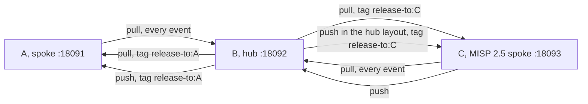

# Testing

## TL;DR

Unit tests on the Python library, an upstream guard that checks the MISP in the image against what this repository patches or depends on, and three stack suites in pytest (`tests/e2e/`): an integration suite on one Compose stack, a hub-spoke sync suite on two instances and a MISP 2.5 partner, and a migration suite that imports a MISP 2.5 database on MariaDB into PostgreSQL, converting it to MISP 3.0. A smoke test checks any live MISP through its API. Two Kubernetes checks cover the Helm chart: every render validated against the schemas, and the chart installed and upgraded on a kind cluster with the smoke test.

```bash
mise run test                # unit tests, the chart lint and every chart render validated against the schemas
mise run test-integration    # the upstream guard, then single-instance integration tests (~2min)
mise run test-sync           # hub-spoke sync test with 2 instances and a MISP 2.5 partner (~4min)
mise run test-migration      # the migration: a MISP 2.5 database on MariaDB into PostgreSQL (~2min)
mise run smoketest https://misp.example.com   # a live MISP; asks for an API key
mise run test-all            # every suite
mise run test-kind           # the chart on a kind cluster: install, helm test, task runs, upgrade, rollback (build the images first)
```

The stack suites build the images with compose, start full MISP stacks, and tear them down. Pass `-- --skip-build` to reuse existing images and `-- --keep` to leave the stack up.

## Unit tests

Tests of the Python entrypoint library (`files/misp_container/`), the scripts and the compose files.

<!-- generated: unit-tests -->
| Module | Tests |
|---|---|
| `test_admin.py` | Unit tests for admin helpers: every value reaches SQL as a parameter. |
| `test_agents_md.py` | AGENTS.md is what scripts/generate_agents_md.py makes of the tree. |
| `test_apply_patches.py` | The patches of patches/ and their applier (scripts/apply_patches.py), on real git trees. |
| `test_chart.py` | The Helm chart renders what the code and the release expect (helm template, no cluster). |
| `test_chart_schema.py` | helm lint, and every render of the chart validated against the Kubernetes and CRD schemas. |
| `test_check_upstream.py` | Unit tests for the upstream guard (scripts/check_upstream.py). |
| `test_compose_files.py` | The test overlays start a service with the same settings under podman-compose and docker compose. |
| `test_config.py` | Unit tests for the config diff engine. |
| `test_config_php.py` | Unit tests for config.php rendering from settings.yaml. |
| `test_configure.py` | Unit tests for the configure step's identity and secret checks. |
| `test_db.py` | Unit tests for the database layer and housekeeping (no PostgreSQL needed). |
| `test_docs.py` | The docs name only what the code has. |
| `test_env.py` | Unit tests for environment variable handling. |
| `test_init.py` | Unit tests for init container logic (file operations, no containers needed). |
| `test_log.py` | Unit tests for the container log formats (LOG_FORMAT json or text). |
| `test_logrelay.py` | Unit tests for the log relay (misp_container.logrelay). |
| `test_metrics.py` | Unit tests for the Prometheus metrics exporter. |
| `test_migrate.py` | Unit tests for the migration Job (misp_container.migrate). |
| `test_release.py` | Unit tests for the release tool (scripts/release.py): the next tag and chart version. |
| `test_s3.py` | Unit tests for the minimal S3 client (misp_container.s3). |
| `test_sync.py` | Unit tests for the org sync engine. |
| `test_task.py` | Unit tests for the periodic task runner. |
| `test_update_settings.py` | Unit tests for the settings catalogue updater (scripts/update_settings.py). |
<!-- end generated -->

Run with: `mise run test` or `PYTHONPATH=files python -m pytest tests/ -v --ignore=tests/e2e`

## Upstream guard

`e2e/test_upstream.py` runs `scripts/check_upstream.py` in one container of the main image,
with the repository mounted, and reports each check as one test. A check reads MISP's own
files and fails when MISP changed something this repository patches or depends on;
DEVELOPING.md lists the checks. A failure names the change, the MISP file and the file of
ours to revisit. No stack starts, so the guard reports even when MISP no longer starts.

`mise run test-integration` and the CI job `integration` run it before the integration suite;
`python -m pytest tests/e2e/test_upstream.py` runs it alone.

## Integration tests

The full MISP stack in Compose, checked feature by feature.

**Stack:** 1 MISP instance (configure + web x2 + caddy + worker + PostgreSQL + Redis + Garage S3 + dex)

| Suite | What it verifies |
|-------|------------------|
| Non-root operation | All containers run as UID 1000 |
| HTTP / Caddy | Login page, static CSS, root redirect |
| Admin user config | Email, password (no forced reset), org name, org UUID, last_pw_change |
| Database settings | DB persistence, setting count, BASE_URL in DB |
| Workers | The five queues run under supervisord, no scheduler program, web reaches supervisord over TCP |
| Background jobs | Event publish triggers job, worker completes it (status=4) |
| PHP-FPM | Listening on port 9002 |
| Distribution files and app/Config | taxonomies in the image, bootstrap.php is MISP's default plus the logging block, database.php on PostgreSQL, config.php content |
| GPG | The key that configure generated into the `misp-gnupg-key` volume, imported into the web container's homedir |
| MISP API | Version endpoint, event create via API |
| Warm restart | A second run over the database groups loads the settings and changes none |
| Defaults version | The configure step records the image version the pods wait for |
| S3 attachment storage | Garage S3 bootstrap, upload, download, bucket verification |
| Custom auth | Header login (200), no-header redirect (302) |
| OIDC login | Redirect to dex, its form, the callback, the user's email, role by name, default organisation, mixed auth |
| Task runner | API tasks, the index tasks without items, the console tasks `periodic-summary` and `check-user-validity`, a missing `ADMIN_KEY` |
| Org sync | Org/user/tag/server creation, server authkey (DB verify), sync user authkey prefix, taxonomy enable, disabled user, custom warninglist create/update, warm run idempotency |
| Metrics exporter | Endpoints, core metrics, no scrape errors, a waiting job in `misp_jobs_queued` and back to 0, `misp_scheduled_tasks_enabled` |
| MISP modules | Enrichment through the modules service |
| Logging | JSON lines from configure and none in text, MISP's own log in the web and worker output once, no CakeLog files on disk, the relay forwarding `server-sync.log`, every log file MISP wrote in web and worker relayed |
| Multi-replica web | configure service ran once, two web replicas serve without configuring |
| Settings | Every MISP setting curated or catalogued, no rejected `cake` setting |

**Files:**
- `e2e/test_integration.py` -- the suite, in the order above; later sections use the state earlier ones leave
- `docker-compose.test.yml` -- overlay on `deploy/docker-compose.yml` (test ports, env, Garage S3, dex). `MISP_TEST_ENV` names one more env file for the MISP containers, layered last; `none.env` is its empty default
- `dex.yaml` -- the OIDC provider's static client and user
- `test-compose.env` -- test env overrides (BASE_URL, ADMIN_EMAIL, etc.)
- `test-compose-secrets.env` -- test secrets (passwords, Redis key), layered over `deploy/chart/files/secrets-*.env`
- `garage.toml` -- Garage S3 config for attachment testing

Run with: `mise run test-integration`

## Kubernetes checks

**Render check** (`tests/test_chart_schema.py`, part of `mise run test`): runs `helm lint
--strict`, renders the chart with the default values, with each component on, with every
component on, and with supplied Secrets, attachments in S3 and a workflow CronJob. It
validates each render with `kubeconform -strict` against the Kubernetes schemas and, for the
Cilium policies and the HTTPRoute, the copies of the datree CRD catalog in `tests/schemas/`. It needs `helm` and `kubeconform` (`mise
install` in the repository); without `kubeconform` the render tests skip, and in CI they
fail. It runs with the unit tests (CI job: `unit`). `test_chart.py` checks what the renders
hold.

**kind test** (`tests/run-kind-test.sh`): creates a kind cluster, loads the three images
under the tag `kind`, and installs the chart with `tests/kind/values.yaml`. Each step must
pass:

1. The configure Job and the Deployments finish; the smoke test (`e2e/test_smoke.py`) passes
   through a port-forward on 38080, and so does the chart's `helm test`.
2. An API task (`update-noticelists`), a console task (`periodic-summary`) and a housekeeping
   task (`housekeeping-jobs`), each started from its CronJob, succeed.
3. An upgrade with a changed value runs `configure-2`, removes `configure-1` and rolls the web
   pods; the smoke test passes.
4. `helm rollback` to revision 1 runs `configure-1` again, removes `configure-2`, restores the
   value and rolls the web pods; the smoke test and `helm test` pass.

On a failure it prints the pods, the events and the logs. `--keep` leaves the cluster
running. CI job: `kind`.

| Value | Why |
|-------|-----|
| The `postgres` and `redis` components, namespace `misp` | The smallest deployment that runs |
| The `cronjobs` and `housekeeping` components | The task runs start from their CronJobs |
| Test values for `misp-db`, `misp-app`, `misp-admin`, `MISP_UUID` | The configure Job refuses the chart's placeholders |
| A ReadWriteOnce attachments claim | kind's local-path storage offers no ReadWriteMany |

The images must exist locally as `ghcr.io/oivindoh/misp-container{,-caddy,-modules}:${MISP_IMAGE_TAG}`; the tag defaults to the chart's `appVersion`, as the Compose files do.
With podman, kind runs on the machine's rootful connection (`KIND_PODMAN_CONNECTION`, default
`podman-machine-default-root`), because a kind node needs privileges that rootless podman
does not give it. kind copies `HTTP_PROXY` and `HTTPS_PROXY` into the node, so a proxy on
localhost breaks the image pulls there.

## Hub-spoke sync test

MISP server-to-server synchronisation between isolated instances: two on this tree's images
and a partner on MISP 2.5.

**Stack:** the hub B and the spoke A, each with the deploy stack's PostgreSQL, Redis,
configure, web, caddy and worker, and the spoke C: MISP 2.5.50 from the MISP project's own
images (`misp-core` and `misp-nginx`, pinned by digest) on MariaDB and Redis. The fixture
writes them into one Compose file from `deploy/docker-compose.yml`, with an env file per
instance. Each instance sets its admin key from `ADMIN_KEY`. The sync container configures A
and B. C gets its sync user and its server for B through its API, because the sync container
writes authkeys into PostgreSQL.



| Phase | What it verifies |
|-------|------------------|
| Setup | All instances ready; A and B configured via the sync container, C through its API |
| Pull (unfiltered) | B pulls the event from A and the one from C |
| Tagging | B tags it release-to:A, and creates one event tagged release-to:A and one release-to:C |
| Pull (tag-filtered) | A gets the release-to:A event, not the release-to:C one; C gets the release-to:C event, not the release-to:A one |
| Push (tag-filtered) | B pushes a tagged event to A; an untagged one stays on B |
| Push from MISP 2.5 | C pushes an event to B |
| Hub layout | A holds no active servers; B pulls from it, then pushes A and C only the events tagged for each |

Pulls and pushes are POSTs; a refused call fails the suite. Before each check the suite waits
until no job on the instance is unfinished.

**Files:**
- `e2e/test_sync.py` -- the suite, with the stack it writes to `$TMPDIR/hub-spoke`; one module fixture per phase
- `test-compose-secrets.env` -- the secrets of every instance

Run with: `mise run test-sync`

## Migration suite

`e2e/test_migration.py` loads a MISP 2.5 database into MariaDB: MISP's own `INSTALL/MYSQL.sql`
of v2.5.50, fetched from GitHub at its commit, then `migrate-source.sql` (an org with a user,
an admin and a sync user with known authkeys, a sync server, an event with an attachment). It
records the row counts. The mounted source files hold the event's attachment and one attachment
in each place MISP keeps one on disk: flat, under `bucket_<n>/` and under `shadow/`. The suite
then runs the migrate Job of this tree's image into PostgreSQL with
`MIGRATE_SOURCE_UPGRADE=true`, which converts the source to MISP 3.0 first, and checks the
refusals (a non-empty target, an identity mismatch, `MIGRATE_FORCE` alone on the Job's own
copy, then with `MIGRATE_REPLACE_COPY`). It runs this tree's images on the copy and checks it:
row counts, both authkeys, the org, the server, the event, the attachment download, the fixture
attachments under MISP's keys, `MISP.live` set by the configure step, the run record and the id
sequences. A forced second copy uploads the attachments into an S3 bucket in garage; the same
checks run on it, plus a new attachment that MISP must write to the bucket. A last run copies
that bucket into a second one and compares every key and byte.

**Files:**
- `e2e/test_migration.py` -- the suite; module fixtures carry each step's state to the next
- `e2e/stack.py`, `e2e/conftest.py` -- the stack helper and the options every pytest suite shares (see below)
- `docker-compose.migrate.yml` -- overlay: the source's MariaDB (`mysql`) and the migrate service with the fixture files mounted
- `migrate-source.sql` -- the rows of the source, on top of MISP's 2.5 schema
- `migrate-target-s3.env` -- puts the attachments in the bucket `misp-migrated`, after the second copy
- `e2e/garage.py` -- layout, keys and buckets in the test stack's garage

Run with: `mise run test-migration` (`-- --skip-build`, `-- --keep`)

## Smoke test

`e2e/test_smoke.py` checks a live MISP through its API: the login page, API auth,
the version, `MISP.baseurl` and `MISP.live`, the org, event and user indexes, supervisord and
the five worker queues, the enrichment URL, and an event created and deleted. `--url` names
the MISP; without `--key` only the login page is checked; without `--url` the module skips.

Run with: `mise run smoketest https://misp.example.com`

## Stack suites in pytest

The stack suites and the smoke test are pytest modules in `tests/e2e/`. The unit run leaves
them out (`--ignore=tests/e2e`).

| Piece | Does |
|-------|------|
| `stack.py` | The `Stack` class: compose calls, `exec` and logs through the engine (a third of a compose call), SQL through the image's db layer, HTTP to MISP, waits, the log dump after a failure |
| `conftest.py` | `--skip-build`, `--keep` (leave the stack up), `--url` and `--key` for the smoke test, a fixture that tells a module whether one of its tests failed, and the log dump at a module's first failure |

A suite is one module. Module fixtures run each step once and hand its result on; the tests
run in file order. At a module's first failure every service's log goes to
`$TMPDIR/<suite>-first-failure-compose-logs.txt`, and after a failure the teardown writes
`$TMPDIR/<suite>-compose-logs.txt`. When MISP never answers while a stack starts, before any
test runs, the logs go to `$TMPDIR/misp-wait-timeout-compose-logs.txt`. CI uploads them all with
the JUnit report. The first dump keeps the log of a container that a later step removes, such
as a web replica.

The suites behave the same under podman-compose, locally, and docker compose, in CI:

- **Read-only containers.** podman mounts a writable tmpfs on `/tmp`, `/run` and `/var/tmp`
  of a read-only container; docker and Kubernetes do not. Under podman the `Stack` passes
  `--read-only-tmpfs=false`, so a write there fails locally as it fails in CI and on a cluster.
- **Env files.** An overlay's `env_file` list repeats the list it overrides, then adds its own
  files. podman-compose appends an override list; docker compose merges it and drops repeats.
  Only a repeated prefix gives both the same settings; `test_compose_files.py` fails on a list
  that breaks the rule.

## CI

GitHub Actions on every push to master, every tag and every pull request:

| Job | Runs |
|-----|------|
| `gate` | Decides what the run does: nothing on a master push whose commit carries a release tag, since the tag run tests and releases that commit; the unit tests only on a draft; no unit tests and no suites on a push to master that merges a pull request, which ran them on the same tree |
| `build` | The three images into the layer cache. The misp image's final stage is built fresh each run, so it carries the current Debian packages |
| `unit` | The unit tests, the chart lint and every chart render validated against the schemas |
| `suite` | The stack suites, one job each, in parallel, against the images from `build` (`MISP_IMAGE_TAG=ci`): `integration` (the upstream guard, then the integration suite), `hub-spoke` and `migration`. Each uploads its JUnit report and, after a failure, the compose logs |
| `kind` | The chart on a kind cluster: install, smoke test, `helm test`, task runs, upgrade, rollback |
| `scan` | Trivy on the three images, one scan each: CRITICAL and HIGH findings with a fix go to the Security tab, and a CRITICAL one fails the job, which blocks `publish` |
| `ci-ok` | The one required check: fails when a job failed or was cancelled, and on a draft |
| `publish` | After every other job, on a tag: the images, the chart and the GitHub Release |

## Environment

All tests require podman with a compose provider (`podman compose`). Set `COMPOSE_CMD` and `CONTAINER_CMD` to use another runner, as CI does with `docker compose` and `docker`. Unit tests also need Python 3.13, uv and helm, which mise installs. The `mise.toml` auto-creates a venv on `cd` into the repo.
